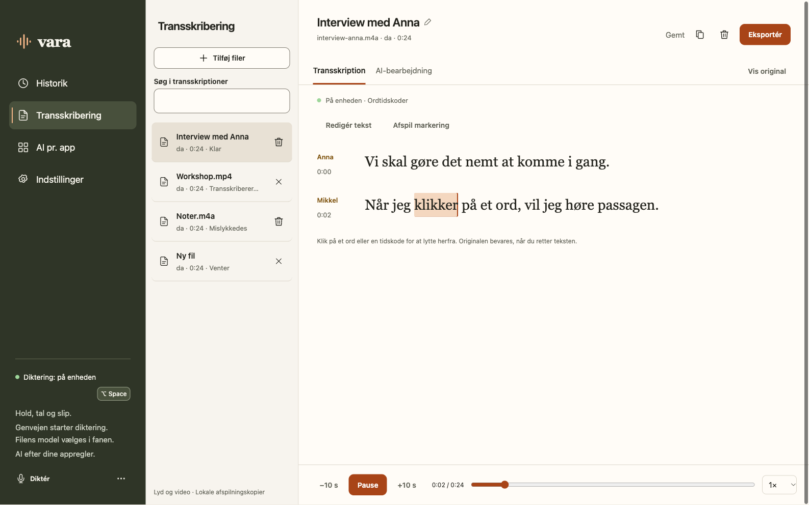

<div align="center">


# Vara

### Fra tanke til tekst. Bare tal.

Diktér dér, hvor du arbejder. Gør optagelser til tekst, du kan bruge.Med lokal behandling som udgangspunkt og AI, når du ønsker det.

**Din stemme · Din arbejdsgang · Dit valg**

[Kom i gang](#kom-i-gang) · [Se funktionerne](#plads-til-det-du-vil-sige) · [For udviklere](#bygget-til-at-vokse)

</div>

<br>



<div align="center"><sub>Et roligt arbejdsrum til din stemme. Her vist med eksempeldata fra appens UI-test.</sub></div>

<br>

## Plads til det, du vil sige

En mail, der skal af sted. En idé, du ikke vil miste. Et interview, du skal arbejde videre med. Vara hjælper dig fra tale til tekst uden at gøre værktøjet til hovedpersonen.

### Hold. Tal. Slip.

Hold din valgte genvej nede, sig det, du vil skrive, og slip. Vara transskriberer og indsætter teksten i det aktive tekstfelt, så du kan blive i din arbejdsgang.

Du vælger selv genvejen — også enkelte taster eller kombinationer af modifikationstaster. Foretrækker du at slå optagelse til og fra, kan du vælge det i stedet.

- **Skriv i dine apps.** Brug stemmen til mails, noter, beskeder og andre tekstfelter.
- **Bevar kontrollen.** Skifter fokus undervejs, ligger teksten klar til manuel indsættelse.
- **Find det igen.** Dikteringer gemmes og grupperes efter den app, du brugte.
- **Behold din udklipsholder.** Automatisk indsættelse bevarer det, du allerede havde kopieret.

### Fra optagelse til overblik

Tilføj lyd- eller videofiler i **Transskribering**, vælg model, og lad Vara tage dem i kø. Lyt, læs og ret i samme arbejdsrum.

| Det vil du gøre | Det hjælper Vara med |
| --- | --- |
| Finde et bestemt øjeblik | Klik på ord eller tidskoder for at lytte dér, når modellen leverer tidskoder. |
| Høre en passage igen | Markér en passage, og afspil den. |
| Se, hvem der taler | Brug valgfri lokal taleropdeling med **Who**, og giv talerne navne. |
| Rette teksten | Redigér med automatisk lagring, mens originalen bevares. |
| Arbejde videre et andet sted | Eksportér som TXT, Markdown, JSON eller undertekster i SRT, når tidskoder findes. |

Who finder stemmer i optagelsen; du sætter selv navn på personerne. Korte optagelser og vanskelig lyd kan give manglende eller usikker taleropdeling.

### Din tekst. Med eller uden AI.

Direkte transskription er standard. Nogle gange er det præcis dét, du har brug for. Andre gange skal talen blive til en kort mail, et mere læsbart notat eller en tekst med en bestemt tone.

Slå AI-bearbejdning til, når du ønsker det, eller knyt en fast systemprompt til en bestemt app. Vara viser den færdige tekst først og gemmer også originalen, så du kan se, hvad der er ændret.

Brug eksempelvis **Qwen gennem Ollama** lokalt, eller forbind en cloududbyder med din egen API-nøgle. Talegenkendelse og tekstbearbejdning vælges hver for sig.

## Lokalt som udgangspunkt

Vara starter med lokal talegenkendelse. Du henter modellen én gang, og derefter behandles lyden på din computer. **Parakeet Redux** er standard; **Whisper Base** er et lokalt alternativ.

Vil du bruge cloud, kan du vælge blandt andet **OpenAI**, **Groq** eller dit eget endpoint. Du bruger dine egne nøgler og din egen udbyderkonto. Der er ingen Vara-konto eller Vara-abonnement at oprette.

- **Nøgler i systemets nøglelager.** Appen viser, om en nøgle er gemt, og lader dig teste forbindelsen.
- **Historik på din computer.** Behold dikteringer, indtil du sletter dem, eller vælg automatisk oprydning.
- **Kort levetid for dikteringslyd.** Lyd slettes efter vellykket transskription. Ved fejl beholdes den til genprøvning i højst 24 timer.
- **Afspilning af importerede filer.** Vara beholder en privat lydkopi, indtil du sletter dokumentet. Dine kildefiler ændres ikke.

<details>
<summary><strong>Hvad forlader computeren?</strong></summary>

Ved lokal talegenkendelse sendes lyden ikke til en transskriptionstjeneste. Vælger du cloud til tale eller tekst, sendes det relevante indhold til den valgte udbyder.

Who kører også lokalt. Varas tilpassede udgave af leverandørens SDK sender dog et installations-id samt app-, model- og platformoplysninger til sin licenstjeneste. Det sender ikke lyd eller transskriptionstekst. Det oplyses i appen før download og brug. Who har sin egen leverandørlicens.

</details>

## Kom i gang

**Vara er i aktiv udvikling. Den nuværende app er bygget og afprøvet på macOS.** En offentlig downloadpakke og automatiske opdateringer er endnu ikke klar.

Har du allerede appen installeret:

1. **Åbn Vara.** Vælg lokal talegenkendelse og hent modellen, eller forbind en cloududbyder.
2. **Vælg din genvej.** Giv macOS de nødvendige tilladelser til mikrofon, globale genveje og indsættelse.
3. **Prøv din første diktering.** Åbn et tekstfelt i en app, hold genvejen nede, tal og slip.

Til længere optagelser: Åbn **Transskribering**, tilføj dine filer, og start transskriptionen.

| Platform | Status |
| --- | --- |
| **macOS** | Den aktive og afprøvede desktopversion. macOS 13+; Who kræver macOS 15+. |
| **Windows og Linux** | Planlagte desktopmål. Native integration, pakning og sluttest mangler. |
| **iOS og Android** | Mulig senere udvidelse med den fælles Rust-motor. Ingen mobilapp endnu. |

Appen signeres med Apple Developer ID, men er endnu ikke notariseret. Filunderstøttelsen afhænger af format og codec; en separat installeret FFmpeg kan udvide den. Se [aktuel status](IMPLEMENTATION.md) og [udgivelsesvejledningen](RELEASING.md).

## Bygget til at vokse

Vara har en fælles kerne og motor i **Rust**, en **Tauri**-desktopapp og klare **GDD-kontrakter** mellem modulerne. Talegenkendelse, tekstbearbejdning og platformfunktioner kan udvikles hver for sig. Kernen og motoren afhænger ikke af desktopgrænsefladen.

<details>
<summary><strong>Byg og kør selv</strong></summary>

Installér projektets fastlåste Rust-toolchain, CMake, en native C/C++-toolchain og Tauri 2's platformforudsætninger. På Mac kræves Xcode-kommandolinjeværktøjerne; Who-runtime kræver Swift 6.2+. Den signerede Mac-pakke kræver et installeret Developer ID-certifikat.

```sh
cargo install tauri-cli --locked
cargo tauri dev
```

Kør tests og byg den signerede macOS-app:

```sh
CARGO_INCREMENTAL=0 CARGO_PROFILE_RELEASE_DEBUG=0 cargo test --release --workspace --locked
sh scripts/build-desktop-macos.sh
```

Appen bygges i `target/release/bundle/macos/Vara.app`. Følg [desktopvejledningen](desktop/README.md) for opsætning, modeller og tilladelser.

</details>

<details>
<summary><strong>Find rundt i projektet</strong></summary>

| Mappe | Ansvar |
| --- | --- |
| `crates/vara-core` | Domæne, indstillinger og lagring |
| `crates/vara-engine` | Lokale modeller, transskription og udbydere |
| `crates/vara-platform` | Lyd, nøgler, genveje og indsættelse |
| `desktop` | Desktopapp, brugerflade og pakning |
| `gdd` | Produktspecifikation, kontrakter, design og testresultater |
| `scripts` | Build, designsynkronisering og modelmålinger |

Designets kilder ligger i `gdd/design`. Den tidligere Swift-app findes kun i Git-historikken; Rust/Tauri-versionen er den aktive app.

</details>

[Produktspecifikation](gdd/PRODUCT-SPEC.md) · [Design](gdd/DESIGN.md) · [Kontrakter](gdd/CONTRACTS.md) · [Test af transskription](gdd/reports/transcription/README.md) · [Test af Who](gdd/reports/who/README.md)

---

<div align="center">

**Mindre afstand mellem det, du tænker, og det, du skriver.**

</div>
