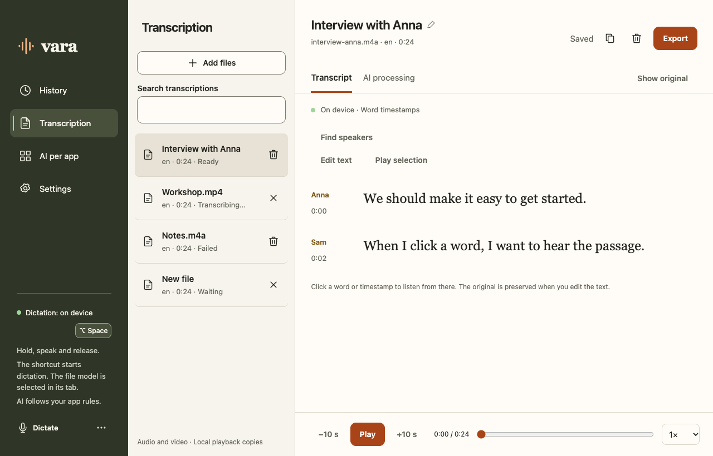

<div align="center">


# Vara

### From thought to text. Just speak.

Dictate wherever you work. Turn recordings into text you can use. Local processing by default, with AI whenever you want it.

**Your voice · Your workflow · Your choice**

[Get started](#get-started) · [Explore the features](#room-for-what-you-want-to-say) · [For developers](#built-to-grow)

</div>

<br>



<div align="center"><sub>A calm workspace for your voice. Shown here with fictional data adapted from the app's UI tests.</sub></div>

<br>

## Room for what you want to say

An email to send. An idea you don't want to lose. An interview to work through. Vara helps you move from speech to text without letting the tool take centre stage.

### Hold. Speak. Release.

Hold down your chosen shortcut, say what you want to write, and release it. Vara transcribes and inserts the text into the active text field, so you can stay in your flow.

You choose the shortcut — including individual keys or combinations of modifier keys. If you prefer to toggle recording on and off, you can choose that instead.

- **Write in your apps.** Use your voice for emails, notes, messages and other text fields.
- **Stay in control.** If focus changes along the way, your text is ready to insert manually.
- **Find it again.** Dictations are saved and grouped by the app you used.
- **Keep your clipboard.** Automatic insertion preserves what you had already copied.

### From recording to clarity

Add audio or video files in **Transcription**, choose a model, and let Vara queue them up. Listen, read and edit in the same workspace.

| What you want to do | How Vara helps |
| --- | --- |
| Find a particular moment | Click words or timestamps to listen from that point when the model provides timestamps. |
| Hear a passage again | Select a passage and play it back. |
| See who's speaking | Use optional local speaker diarization with **Who**, and give speakers names. |
| Correct the text | Edit with automatic saving while the original is preserved. |
| Continue working elsewhere | Export as TXT, Markdown, JSON or SRT subtitles when timestamps are available. |

Who identifies voices in a recording; you name the people yourself. Short recordings and difficult audio can result in missing or uncertain speaker diarization.

### Your text. With or without AI.

Direct transcription is the default. Sometimes that's exactly what you need. At other times, you want to turn speech into a short email, a more readable note or text with a particular tone.

Turn on AI processing whenever you want, or assign a fixed system prompt to a specific app. Vara shows the finished text first and also saves the original, so you can see what changed.

For example, use **Qwen through Ollama** locally, or connect a cloud provider with your own API key. Speech recognition and text processing are selected separately.

## Local by default

Vara starts with local speech recognition. Download the model once, and your audio is then processed on your computer. **Parakeet Redux** is the default; **Whisper Base** is a local alternative.

If you want to use the cloud, you can choose **OpenAI**, **Groq** or your own endpoint, among others. You use your own keys and provider account. There is no Vara account or subscription to set up.

- **Keys in the system keychain.** The app shows whether a key is saved and lets you test the connection.
- **History on your computer.** Keep dictations until you delete them, or choose automatic cleanup.
- **Short-lived dictation audio.** Audio is deleted after successful transcription. If transcription fails, it is kept for retry for up to 24 hours.
- **Playback of imported files.** Vara keeps a private audio copy until you delete the document. Your source files are not changed.

<details>
<summary><strong>What leaves your computer?</strong></summary>

With local speech recognition, audio is not sent to a transcription service. If you choose the cloud for speech or text, the relevant content is sent to your chosen provider.

Who also runs locally. However, Vara's adapted version of the vendor's SDK sends an installation ID and app, model and platform information to its licensing service. It does not send audio or transcription text. This is disclosed in the app before download and use. Who has its own vendor licence.

</details>

## Get started

**Vara is in active development. The current app is built and tested on macOS.** Version [1.0.2 is available for macOS Apple Silicon](https://github.com/mikkelkrogsholm/vara/releases/tag/v1.0.2), Developer ID signed and notarized. Download and install updates directly from Settings. See the [release guide](RELEASING.md).

If you already have the app installed:

1. **Open Vara.** Choose local speech recognition and download the model, or connect a cloud provider.
2. **Choose your shortcut.** Grant macOS the necessary permissions for the microphone, global shortcuts and insertion.
3. **Try your first dictation.** Open a text field in an app, hold down the shortcut, speak and release.

For longer recordings: Open **Transcription**, add your files and start transcription.

**Settings → Updates** shows your running version. When a newer release is available, use the update notice to download it, then choose **Install and restart** after saving your work. You can also check manually in Settings.

| Platform | Status |
| --- | --- |
| **macOS** | The active and tested desktop version. macOS 13+; Who requires macOS 15+. |
| **Windows and Linux** | Planned desktop targets. Native integration, packaging and final testing are still needed. |
| **iOS and Android** | Possible future expansion using the shared Rust engine. No mobile app yet. |

On macOS, agents can use the bundled `vara` command; see the [CLI guide](CLI.md) for installation and examples.

The 1.0.2 macOS Apple Silicon release is Developer ID signed and notarized. File support depends on the format and codec; a separately installed FFmpeg can extend it. See the [current status](IMPLEMENTATION.md) and [release guide](RELEASING.md).

## Contribute

Help improve Vara with documentation, testing, translations or bug fixes. The
[contributor guide](CONTRIBUTING.md) explains how to get started and open a pull request.

## Built to grow

Vara has a shared core and engine in **Rust**, a **Tauri** desktop app and clear **GDD contracts** between modules. Speech recognition, text processing and platform features can be developed independently. The core and engine do not depend on the desktop interface.

<details>
<summary><strong>Build and run it yourself</strong></summary>

Install the project's pinned Rust toolchain, CMake, a native C/C++ toolchain and the Tauri 2 platform prerequisites. On Mac, Xcode command-line tools are required; the Who runtime requires Swift 6.2+. The signed Mac package requires an installed Developer ID certificate.

```sh
cargo install tauri-cli --locked
cargo tauri dev
```

Run tests and build the signed macOS app:

```sh
CARGO_INCREMENTAL=0 CARGO_PROFILE_RELEASE_DEBUG=0 cargo test --release --workspace --locked
sh scripts/build-desktop-macos.sh
```

The app is built at `target/release/bundle/macos/Vara.app`. Follow the [desktop guide](desktop/README.md) for setup, models and permissions.

</details>

<details>
<summary><strong>Explore the project</strong></summary>

| Directory | Responsibility |
| --- | --- |
| `crates/vara-core` | Domain, settings and storage |
| `crates/vara-engine` | Local models, transcription and providers |
| `crates/vara-platform` | Audio, keys, shortcuts and insertion |
| `desktop` | Desktop app, interface and packaging |
| `gdd` | Product specification, contracts, design and test results |
| `scripts` | Build, design synchronization and model measurements |

Vara is licensed under the [MIT License](LICENSE). Third-party software and models have separate notices and licenses; see [bundled notices](desktop/src-tauri/notices).

Design sources are in `gdd/design`. The earlier Swift app exists only in Git history; the Rust/Tauri version is the active app.

</details>

[Contributing](CONTRIBUTING.md) · [Changelog](CHANGELOG.md) · [License](LICENSE) · [Product specification](gdd/PRODUCT-SPEC.md) · [Design](gdd/DESIGN.md) · [Contracts](gdd/CONTRACTS.md) · [Transcription tests](gdd/reports/transcription/README.md) · [Who tests](gdd/reports/who/README.md)

---

<div align="center">

**Less distance between what you think and what you write.**

</div>
