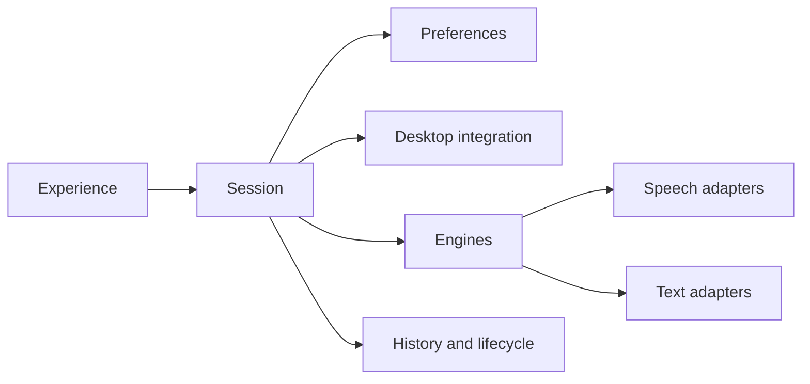

# Vara v1 — module contracts

Derived from `gdd.json`; the graph owns action/type/scenario details. Regenerate this view with `python3 render_contracts.py`. These are implementation contracts and proposed design boundaries, not executed application evidence.

## Ownership

| Module | Owns | Excludes |
| --- | --- | --- |
| `component.session` | Own the dictation lifecycle, generation validity and finalization order. | OS calls, provider protocols, storage implementation. |
| `component.desktop` | Own microphone, shortcut, permissions, focus identity and clipboard-safe OS delivery. | Prompt selection, provider networking and history retention. |
| `component.engines` | Expose separately typed speech/text capabilities and provider readiness through adapters. | Session delivery, application policy and history ownership. |
| `component.preferences` | Resolve deliberate processing choices into immutable per-session plans. | Running providers, reading target app content and owning secrets. |
| `component.history` | Own durable text, staged recovery and bounded temporary audio lifecycle. | Provider protocols and implicit paste replay. |
| `component.experience` | Present onboarding, history, configuration and honest session status. | OS focus decisions, secret values and provider protocol logic. |
| `component.transcription` | Own durable file jobs and document library independently from OS dictation delivery and captured-audio retention. | OS focus/insertion, provider protocols, changing or deleting user original files. |

## Main flow

One application, shared Rust domain core. Public calls are explicit `calls` edges. Adapters do not own session policy, delivery or history. Module identifiers describe responsibility, not a required crate count.

## Shared boundary semantics

- Entity references are opaque logical identities, not implicit embedded payloads. Audio, staged text and secrets stay behind private handles. UI receives only the data projection it needs.
- Timestamps are UTC instants; the implementation defines serialized ID/time formats consistently. Audio expiry derives from original capture creation, never retry time.
- Generation identity travels through async calls. The session rejects stale responses independently of provider cancellation support.
- New profiles are empty, direct and local. App identity, prompt, engine and policy are snapshotted at invocation.
- Result commit precedes irreversible OS dispatch. A durable result is not proof that another app received text. Uncertain dispatch is never automatically replayed.
- Errors are typed domain outcomes; redact secrets and content from diagnostics. A successful operation may still carry explicit nonfatal cleanup state.
- `effects_complete` and `dependencies_complete` describe declared contract coverage, not proof that a future implementation conforms.

## Data contracts

`?` means the field may be absent; `or null` permits a present null value. Reference IDs do not automatically embed the referred entity.

### Invocation target
`entity.destination`

Invocation target data contract. Handles are opaque; references identify logical records, never embedded secrets or binary audio.

| Field | Type |
| --- | --- |
| `app_id` | string |
| `app_label` | string |
| `target_token` | string |
| `identity_known` | boolean |

### Immutable processing plan
`entity.plan`

Immutable processing plan data contract. Handles are opaque; references identify logical records, never embedded secrets or binary audio.

| Field | Type |
| --- | --- |
| `speech_engine_id` | string |
| `text_engine_id` | string? |
| `mode` | direct  /  general_prompt  /  app_prompt |
| `system_prompt` | string? |
| `audio_location` | on_device  /  lan  /  cloud  /  unknown |
| `text_location` | none  /  on_device  /  lan  /  cloud  /  unknown |
| `strict_local` | boolean |
| `settings_revision` | string |

### Session
`entity.session`

Session data contract. Handles are opaque; references identify logical records, never embedded secrets or binary audio.

| Field | Type |
| --- | --- |
| `generation` | string |
| `destination` | destination ID |
| `plan` | plan ID |
| `state` | capturing  /  recognizing  /  processing  /  finalizing  /  completed  /  cancelled  /  failed |
| `cancelled` | boolean |

### Private capture
`entity.capture`

Private capture data contract. Handles are opaque; references identify logical records, never embedded secrets or binary audio.

| Field | Type |
| --- | --- |
| `owner_generation` | string |
| `audio_handle` | string |
| `created_at` | string |
| `expires_at` | string |
| `state` | capturing  /  recognizing  /  retry_available  /  deletion_pending |

### Completed dictation
`entity.result`

Completed dictation data contract. Handles are opaque; references identify logical records, never embedded secrets or binary audio.

| Field | Type |
| --- | --- |
| `id` | string |
| `generation` | string |
| `origin_app_id` | string |
| `created_at` | string |
| `original` | string |
| `processed` | string? |
| `processing_status` | direct  /  processed  /  fallback_original |
| `delivery` | pending  /  inserted  /  manual_ready  /  failed  /  unknown |
| `plan` | plan ID |

### Engine capability
`entity.engine`

Engine capability data contract. Handles are opaque; references identify logical records, never embedded secrets or binary audio.

| Field | Type |
| --- | --- |
| `id` | string |
| `kind` | speech  /  text |
| `location` | on_device  /  lan  /  cloud  /  unknown |
| `readiness` | missing  /  downloading  /  needs_auth  /  ready  /  unsupported  /  error |
| `model` | string |
| `credential_handle` | string? |
| `supports_cancel` | boolean |

### Application processing preference
`entity.app_processing_settings`

Application processing preference data contract. Handles are opaque; references identify logical records, never embedded secrets or binary audio.

| Field | Type |
| --- | --- |
| `app_id` | string |
| `enabled` | boolean |
| `system_prompt` | string |
| `text_engine_id` | string |
| `revision` | string |

### User preferences
`entity.policy`

User preferences data contract. Handles are opaque; references identify logical records, never embedded secrets or binary audio.

| Field | Type |
| --- | --- |
| `activation_style` | hold  /  toggle |
| `shortcut` | string |
| `speech_engine_id` | string |
| `general_ai_enabled` | boolean |
| `general_prompt` | string |
| `general_text_engine_id` | string? |
| `strict_local` | boolean |
| `retention_days` | integer? |

### Runtime capability report
`entity.capability_matrix`

Runtime capability report data contract. Handles are opaque; references identify logical records, never embedded secrets or binary audio.

| Field | Type |
| --- | --- |
| `os` | macos  /  windows  /  linux |
| `environment` | string |
| `capture` | boolean |
| `global_shortcut` | boolean |
| `target_identity` | boolean |
| `automatic_insert` | boolean |
| `limitations` | list<string> |

### Private recovery task
`entity.recovery`

Private recovery task data contract. Handles are opaque; references identify logical records, never embedded secrets or binary audio.

| Field | Type |
| --- | --- |
| `id` | string |
| `kind` | failed_audio  /  interrupted_text |
| `generation` | string |
| `origin` | destination ID |
| `plan` | plan ID |
| `payload_handle` | string |
| `created_at` | string |
| `expires_at` | string? |

### Timed word
`entity.file_word`

An ASR/alignment estimate relative to media start; identity stable within the original. Edited text does not inherit timing.

| Field | Type |
| --- | --- |
| `id` | string |
| `text` | string |
| `start_seconds` | number |
| `end_seconds` | number |
| `speaker_id` | string? |

### File transcription document
`entity.file_document`

Own imported-source provenance, stage, preserved transcript, optional correction, separate AI and explicit timing precision. Playback copy is distinct from dictation capture.

| Field | Type |
| --- | --- |
| `id` | string |
| `source_name` | string |
| `title` | string |
| `engine` | engine ID |
| `stage` | queued  /  decoding  /  transcribing  /  ready  /  failed  /  cancelled |
| `edited_text` | string? |
| `ai_text` | string? |
| `revision` | integer |
| `transcript` | file_transcript ID? |
| `diarization` | diarization ID? |
| `diarization_error` | string? |

### Transcript segment
`entity.file_segment`

Original readable segment with optional real timing, optional speaker and stable timed words.

| Field | Type |
| --- | --- |
| `id` | string |
| `text` | string |
| `start_seconds` | number? |
| `end_seconds` | number? |
| `speaker_id` | string? |
| `words` | list<file_word ID> |

### Original file transcript
`entity.file_transcript`

Original text and actual timing precision. Corrections and AI never mutate this object.

| Field | Type |
| --- | --- |
| `text` | string |
| `timing` | none  /  segment  /  word |
| `timing_source` | none  /  asr  /  alignment |
| `segments` | list<file_segment ID> |

### Speaker interval
`entity.speaker_turn`

Independent Who interval; different speakers may overlap. Uncertain text is not assigned by guesswork.

| Field | Type |
| --- | --- |
| `speaker_id` | string |
| `start_seconds` | number |
| `end_seconds` | number |

### Local speaker annotation
`entity.diarization`

Separate from immutable source ASR and corrections; pinned model provenance and real intervals.

| Field | Type |
| --- | --- |
| `model` | string |
| `version` | string |
| `turns` | list<speaker_turn ID> |

## Session

### Run one dictation
`action.use_vara`

**Input:** `command`: start | stop.

**Output:** { session: session ID, state: string }.

On start snapshot origin and resolve policy; acquire capture. On stop recognize speech, delete successful audio, optionally process text, save one result then request focus-safe delivery. Serialize cancellation and finalization; reject stale generations.

**Guarantee:** A valid generation produces at most one completed result, grouped by invocation app, with separate delivery status.

**Effects:** Calls declared capture, provider, temporary storage, result commit and desktop-delivery interfaces.

| Error | Required behavior |
| --- | --- |
| `Busy` | Keep the original session; report Busy without overlapping capture. |
| `StorageUnavailable` | Keep available text in memory for explicit copy/retry; do not paste or claim saved. |
| `NoSpeech` | Delete capture audio, publish no history and insert no text. |

Scenario IDs: `scenario.use_vara.busy`, `scenario.use_vara.storageunavailable`, `scenario.use_vara.nospeech`, `scenario.use_vara.normal`, `scenario.use_vara.idempotency`, `scenario.use_vara.concurrency`, `scenario.use_vara.atomicity`, `scenario.acceptance_same_app_new_field`, `scenario.acceptance_snapshot_prompt_origin`, `scenario.acceptance_crash_after_os_dispatch`, `scenario.acceptance_cancel_late_response`.

### Obtain original transcript
`action.transcribe`

**Input:** `session`: session ID; `capture`: capture ID.

**Output:** { outcome: transcript | no_speech, original: string, cleanup_pending: boolean }.

Invoke speech adapter; after success or no_speech request immediate audio deletion independently of text AI/delivery. Stage nonempty original privately for crash recovery. Cleanup failure is a nonfatal cleanup_pending outcome: continue with available original while reporting pending deletion.

**Guarantee:** Recognized text survives later optional AI failure; successful recognition audio is not kept as history.

**Effects:** Calls speech adapter, private text staging and audio lifecycle.

| Error | Required behavior |
| --- | --- |
| `RecognitionFailed` | Mark eligible audio retryable without extending its initial deadline. |

Scenario IDs: `scenario.transcribe.recognitionfailed`, `scenario.transcribe.cleanuppending`, `scenario.transcribe.normal`, `scenario.acceptance_success_audio_ai_failure`.

### Use direct transcript
`action.verbatim`

**Input:** `original`: string.

**Output:** string.

Return original exactly without invoking a generative text engine.

**Guarantee:** Direct mode stores/displays one text representation and preserves recognized text.

**Effects:** No independent external effects.

Scenario IDs: `scenario.verbatim.normal`, `scenario.acceptance_direct_default`.

### Apply optional prompt
`action.rewrite`

**Input:** `original`: string; `plan`: plan ID; `generation`: string.

**Output:** { text: string, processed: boolean, fallback: boolean }.

If the plan selects AI invoke engine_text with snapshotted prompt. On provider error/empty output return original, processed=false, fallback=true with visible status.

**Guarantee:** Successful AI stores both versions. Failure uses the original through ordinary safe delivery, without extra approval.

**Effects:** Calls only the selected text adapter.

Scenario IDs: `scenario.rewrite.normal`, `scenario.acceptance_success_audio_ai_failure`.

### Apply general cleanup choice
`action.cleanup`

**Input:** `original`: string; `plan`: plan ID; `generation`: string.

**Output:** { text: string, processed: boolean, fallback: boolean }.

Delegate to rewrite only when the immutable plan explicitly selects general_prompt or app_prompt; otherwise delegate to verbatim.

**Guarantee:** No text receives AI cleanup solely because a prompt exists.

**Effects:** Calls direct/optional-processing interfaces.

Scenario IDs: `scenario.cleanup.normal`.

### Cancel current generation
`action.cancel`

**Input:** `session`: session ID; `generation`: string.

**Output:** cancelled | already_cancelled | already_committed.

Serialize against finalization. Before commit invalidate generation, stop capture and delete private staging/capture. Request upstream cancel best effort.

**Guarantee:** Accepted cancellation cannot later publish history or insert text; already committed work is reported honestly.

**Effects:** Stops capture/provider work best effort; removes uncommitted private data.

| Error | Required behavior |
| --- | --- |
| `CleanupPending` | Keep generation cancelled; surface cleanup pending and retry physical deletion without publishing data. |

Scenario IDs: `scenario.cancel.cleanuppending`, `scenario.cancel.normal`, `scenario.cancel.idempotency`, `scenario.cancel.concurrency`, `scenario.cancel.atomicity`, `scenario.acceptance_cancel_late_response`.

### Retry failed recognition
`action.retry`

**Input:** `recovery`: recovery ID.

**Output:** session ID.

Check fixed original audio expiry and prior session outcome. Explicit retry reuses the original app/plan; do not assume historical focus is current. On successful recognition delete audio.

**Guarantee:** A retry never extends expiry, duplicates a completed result or pastes into a different target.

**Effects:** Reads eligible temporary audio and calls session recognition/finalization.

| Error | Required behavior |
| --- | --- |
| `Expired` | Refuse retry, schedule immediate deletion and remove the recovery offer. |
| `Busy` | Return its current attempt; do not launch a duplicate provider call. |

Scenario IDs: `scenario.retry.expired`, `scenario.retry.busy`, `scenario.retry.normal`, `scenario.retry.authorization`, `scenario.retry.idempotency`, `scenario.retry.concurrency`, `scenario.acceptance_fixed_audio_expiry`.

### Use saved result manually
`action.retry_delivery`

**Input:** `result`: result ID; `intent`: copy | insert_current_target.

**Output:** copied | inserted | manual_ready | failed | unknown.

Require a deliberate action. Copy replaces clipboard as explicitly requested. Explicit insertion binds a fresh user-selected target and calls the desktop contract.

**Guarantee:** Failed/unknown automatic insertion is never silently replayed. Manual copy is allowed to replace the clipboard by explicit intent.

**Effects:** May copy text to clipboard or deliver to a newly confirmed target; updates delivery status.

| Error | Required behavior |
| --- | --- |
| `Unavailable` | Keep the existing saved result and show the failure. |

Scenario IDs: `scenario.retry_delivery.unavailable`, `scenario.retry_delivery.normal`, `scenario.retry_delivery.authorization`, `scenario.retry_delivery.idempotency`, `scenario.retry_delivery.concurrency`.

## Desktop integration

### Capture microphone audio
`action.capture`

**Input:** `command`: start | stop; `session`: session ID; `device_id`: string.

**Output:** { capture: capture ID, state: recording | stopped }.

Start/stop the chosen input device with bounded buffers, nonactivating status and one capture owner; stop closes the stream.

**Guarantee:** Return an opaque private capture handle; no binary audio enters UI state.

**Effects:** Opens/closes microphone; writes app-private temporary audio.

| Error | Required behavior |
| --- | --- |
| `PermissionDenied` | Do not record; identify the permission and expose the guided permission path. |
| `DeviceUnavailable` | Stop capture and report the device problem; retain only a valid recoverable recording under the audio lifecycle. |

Scenario IDs: `scenario.capture.permissiondenied`, `scenario.capture.deviceunavailable`, `scenario.capture.normal`, `scenario.capture.authorization`, `scenario.capture.idempotency`, `scenario.capture.concurrency`.

### Inspect or request permissions
`action.permissions`

**Input:** `capability`: microphone | automatic_insert; `request`: boolean.

**Output:** { status: granted | denied | not_requested | unsupported, help: string }.

Inspect OS permission first. Request only on deliberate user action and explain the relevant OS route.

**Guarantee:** Report actual grants and unsupported capabilities without pretending success.

**Effects:** May open an OS permission dialog/settings page after deliberate request.

| Error | Required behavior |
| --- | --- |
| `OSFailure` | Report unknown/not-ready with recovery instructions; do not infer a grant. |

Scenario IDs: `scenario.permissions.osfailure`, `scenario.permissions.normal`, `scenario.permissions.authorization`.

### Register activation shortcut
`action.configure_shortcut`

**Input:** `binding`: string; `style`: hold | toggle.

**Output:** policy ID.

Validate and try the new OS binding before replacing the previous working binding. Ignore repeated keydown. Persist activation settings only after successful registration.

**Guarantee:** A working user-selected shortcut invokes hold or toggle semantics; default profile is hold.

**Effects:** Registers/unregisters global shortcut; saves preferences.

| Error | Required behavior |
| --- | --- |
| `Conflict` | Explain the conflict and preserve the previous working binding. |
| `Unavailable` | Report limitation and retain reachable in-app recording controls. |

Scenario IDs: `scenario.configure_shortcut.conflict`, `scenario.configure_shortcut.unavailable`, `scenario.configure_shortcut.normal`, `scenario.configure_shortcut.idempotency`, `scenario.configure_shortcut.concurrency`, `scenario.configure_shortcut.atomicity`.

### Choose input device
`action.input_device`

**Input:** `device_id`: string.

**Output:** { selected_device_id: string }.

List actual audio input devices and validate a selected device without starting recording.

**Guarantee:** Selection affects subsequent captures; active capture is not silently moved.

**Effects:** Saves the selected input device.

| Error | Required behavior |
| --- | --- |
| `Unavailable` | Preserve the last valid selection and ask the user to choose another device. |

Scenario IDs: `scenario.input_device.unavailable`, `scenario.input_device.normal`, `scenario.input_device.concurrency`.

### Report desktop capabilities
`action.desktop_support`

**Input:** none.

**Output:** capability_matrix ID.

Probe runtime APIs for this OS/environment; combine installed build support and actual runtime availability.

**Guarantee:** Report known/unsupported capabilities and honest limitations; source portability is not a passed runtime test.

**Effects:** Reads OS/environment capability information.

Scenario IDs: `scenario.desktop_support.normal`.

### Deliver completed text safely
`action.insert`

**Input:** `result`: result ID; `destination`: destination ID; `automatic`: boolean.

**Output:** inserted | manual_ready | failed | unknown.

Automatic path rechecks exact originating text target immediately before dispatch. Changed or unknown target returns manual_ready. Prefer direct insertion; clipboard fallback snapshots all supported formats, compare-and-restore only while Vara still owns its write.

**Guarantee:** Automatic delivery never intentionally targets a changed field. A newer user copy is preserved. Unknown paste is never automatically replayed.

**Effects:** May insert text into the original focused target and temporarily use clipboard; updates delivery status.

| Error | Required behavior |
| --- | --- |
| `DeliveryFailed` | Keep the saved text manual-ready/failed; do not blindly repeat a possibly committed paste. |
| `ClipboardUnavailable` | Do not destructively use clipboard; retain text for deliberate manual use. |

Scenario IDs: `scenario.insert.deliveryfailed`, `scenario.insert.clipboardunavailable`, `scenario.insert.normal`, `scenario.insert.authorization`, `scenario.insert.idempotency`, `scenario.insert.concurrency`, `scenario.insert.atomicity`, `scenario.acceptance_same_app_new_field`, `scenario.acceptance_clipboard_new_copy`, `scenario.acceptance_snapshot_prompt_origin`, `scenario.acceptance_crash_after_os_dispatch`.

## Engines

### Recognize speech
`action.engine_speech`

**Input:** `capture`: capture ID; `engine`: engine ID; `generation`: string; `plan`: plan ID.

**Output:** { outcome: transcript | no_speech, text: string }.

Validate speech capability, actual readiness and locality against the immutable plan; invoke exactly that adapter. Return transcript or no_speech. Transcript is data; never run a text model here.

**Guarantee:** Return original text without silently switching providers or uploading audio.

**Effects:** Chosen speech adapter reads the private capture and may transmit audio only as explicitly allowed.

| Error | Required behavior |
| --- | --- |
| `NotReady` | Report missing setup and retain failed recognition audio under fixed expiry. |
| `RecognitionFailed` | Return a typed stage failure; retain eligible audio for explicit retry. |
| `PolicyDenied` | Reject before transmitting audio. |

Scenario IDs: `scenario.engine_speech.notready`, `scenario.engine_speech.recognitionfailed`, `scenario.engine_speech.policydenied`, `scenario.engine_speech.normal`, `scenario.engine_speech.authorization`, `scenario.engine_speech.concurrency`.

### Process transcript text
`action.engine_text`

**Input:** `original`: string; `system_prompt`: string; `engine`: engine ID; `generation`: string; `plan`: plan ID.

**Output:** string.

Validate text capability, readiness and location. Keep system instructions separate from transcript data in the adapter protocol. Return nonempty processed text.

**Guarantee:** Text processing never owns capture/history/delivery and cannot silently change destinations.

**Effects:** May transmit original text and prompt to the explicitly selected text engine.

| Error | Required behavior |
| --- | --- |
| `NotReady` | Return typed failure; original remains available. |
| `ProcessingFailed` | Return failure without replacing the original. |
| `PolicyDenied` | Reject before transmitting text. |

Scenario IDs: `scenario.engine_text.notready`, `scenario.engine_text.processingfailed`, `scenario.engine_text.policydenied`, `scenario.engine_text.normal`, `scenario.engine_text.authorization`, `scenario.engine_text.concurrency`.

### Prepare recommended local model
`action.recommended_setup`

**Input:** `command`: inspect | download | cancel | retry; `kind`: speech | text?.

**Output:** engine ID.

Choose the validated bundled model catalog entry for this runtime; disclose download size/storage. Download to staging, verify integrity and publish ready only when load succeeds. Missing kind means speech; explicit text prepares the optional recommended on-device text model through the same installation lifecycle.

**Guarantee:** No terminal/account/key is needed for the default local speech path. Cancelled/incomplete models are not ready.

**Effects:** Downloads model artifacts after deliberate request; manages local model files.

| Error | Required behavior |
| --- | --- |
| `DownloadFailed` | Keep prior ready installation; expose retry and a clear missing/not-ready state. |
| `Unsupported` | Explain limitation without silently selecting cloud. |

Scenario IDs: `scenario.recommended_setup.downloadfailed`, `scenario.recommended_setup.unsupported`, `scenario.recommended_setup.normal`, `scenario.recommended_setup.idempotency`, `scenario.recommended_setup.concurrency`, `scenario.recommended_setup.atomicity`.

### Configure optional engine
`action.advanced_engines`

**Input:** `id`: string; `kind`: speech | text; `provider`: local_model | openai | groq | elevenlabs | anthropic | gemini | ollama | custom_text | claude_code | codex | gemini_cli; `model`: string; `endpoint`: string?; `location`: on_device | lan | cloud | unknown; `credential_handle`: string?.

**Output:** engine ID.

Validate provider capability, actual location and endpoint/model configuration. Cloud speech catalog is OpenAI/Groq/ElevenLabs; cloud text OpenAI/Groq/Anthropic/Gemini; custom/Ollama/installed CLIs text only. Report readiness after capability/auth checks, not by key presence. local_model identifies a validated on-device speech or text runtime, independent of the cloud/CLI catalog.

**Guarantee:** New providers implement the speech or text adapter contract without changes to session/history/desktop ownership.

**Effects:** Saves engine metadata; may explicitly check provider connectivity/capabilities.

| Error | Required behavior |
| --- | --- |
| `InvalidConfiguration` | Keep existing valid configuration; do not report ready. |
| `ConnectionFailed` | Show exact not-ready state without silently switching provider. |

Scenario IDs: `scenario.advanced_engines.invalidconfiguration`, `scenario.advanced_engines.connectionfailed`, `scenario.advanced_engines.normal`, `scenario.advanced_engines.authorization`, `scenario.advanced_engines.atomicity`.

### Store personal provider key
`action.credentials`

**Input:** `provider_id`: string; `secret`: string.

**Output:** { credential_handle: string, status: stored | validated }.

Receive secret only in the key-management path. Store through OS secret storage; return handle only. Clear transient form data; never put key in logs, history, graph or general settings. Validation is explicit and separate from mere storage.

**Guarantee:** Direct cloud providers use the user key; no Vara login/billing proxy. Providers retrieve secrets through private handles.

**Effects:** Writes OS credential storage; explicit auth check may contact provider.

| Error | Required behavior |
| --- | --- |
| `StorageFailed` | Do not fall back to plaintext files; retain previous working key and report setup incomplete. |
| `InvalidKey` | Report rejection without exposing the key or invalidating unrelated providers. |

Scenario IDs: `scenario.credentials.storagefailed`, `scenario.credentials.invalidkey`, `scenario.credentials.normal`, `scenario.credentials.authorization`, `scenario.credentials.atomicity`.

### Invoke optional installed text CLI
`action.cli_processing`

**Input:** `tool`: claude_code | codex | gemini_cli; `original`: string; `system_prompt`: string; `generation`: string; `plan`: plan ID.

**Output:** string.

Inspect real installed tool/version/authentication and supported noninteractive text contract. Invoke without shell interpolation using its genuine user auth. Keep transcript separate from instructions; no arbitrary tools/workspace effects. Report actual model locality.

**Guarantee:** CLI integrations are optional text engines, not a promised subscription speech backend or a claim of on-device inference.

**Effects:** Starts selected installed CLI; its genuine auth may send text to remote model.

| Error | Required behavior |
| --- | --- |
| `Unavailable` | Report unavailable; preserve original for fallback, do not fabricate a login. |
| `ExecutionFailed` | Stop/reap process best effort; return typed text-stage error without exposing tokens. |

Scenario IDs: `scenario.cli_processing.unavailable`, `scenario.cli_processing.executionfailed`, `scenario.cli_processing.normal`, `scenario.cli_processing.authorization`, `scenario.cli_processing.concurrency`.

### Recognize file with real timing
`action.file_recognize`

**Input:** `document`: file_document ID.

**Output:** file_transcript ID.

Stream/bound normalized audio, return original text plus actual word/segment estimates and optional chunk-scoped speakers. Never fabricate times, speaker identity, progress or transcript content.

**Guarantee:** Stream/bound normalized audio, return original text plus actual word/segment estimates and optional chunk-scoped speakers. Never fabricate times, speaker identity, progress or transcript content.

**Effects:** Reads selected media, writes private document/media state, optionally invokes the explicitly selected model and writes an explicitly chosen export path.

| Error | Required behavior |
| --- | --- |
| `Unavailable` | Unavailable model, invalid media/timing, provider error or no speech is an actionable failed job. |

Scenario IDs: `scenario.file_recognize.authorization`, `scenario.file_recognize.boundaries`, `scenario.file_recognize.concurrency`, `scenario.file_recognize.atomicity`.

### Run official Who runtime
`action.engine_diarize`

**Input:** `audio_handle`: string.

**Output:** diarization ID.

Run pinned official Who C ABI with normalized local audio in an isolated registered child. Keep SDK reporting intact and return model/version plus overlapping real speaker intervals. Never upload audio/text or switch providers.

**Guarantee:** Run pinned official Who C ABI with normalized local audio in an isolated registered child. Keep SDK reporting intact and return model/version plus overlapping real speaker intervals. Never upload audio/text or switch providers.

**Effects:** Read local normalized audio/model files; explicit model downloads contact supplier/CDN. Official SDK license/usage requests contain installation/app/model/platform metadata, never audio/text. Write independent local annotation state.

| Error | Required behavior |
| --- | --- |
| `Unavailable` | Validate C ABI payload length, speakers, finite/bounded intervals and source duration. Surface native crashes and empty results honestly. |

Scenario IDs: `scenario.engine_diarize.authorization`, `scenario.engine_diarize.boundaries`, `scenario.engine_diarize.concurrency`, `scenario.engine_diarize.atomicity`.

## Preferences

### Resolve invocation processing plan
`action.resolve_processing`

**Input:** `destination`: destination ID; `one_shot`: default | direct | general_ai.

**Output:** plan ID.

Read a consistent preferences revision. Explicit one-shot overrides first; otherwise enabled app AI uses that app prompt/engine, else deliberately enabled general AI, else direct. Freeze speech/text destination and prompt for this session.

**Guarantee:** Disabled app prompt does not activate AI. New profiles resolve direct/local. Focus/settings changes after invocation do not mutate the plan.

**Effects:** No independent external effects.

| Error | Required behavior |
| --- | --- |
| `InvalidPlan` | Return actionable configuration error; never choose remote fallback. |

Scenario IDs: `scenario.resolve_processing.invalidplan`, `scenario.resolve_processing.normal`, `scenario.resolve_processing.concurrency`, `scenario.acceptance_snapshot_prompt_origin`, `scenario.acceptance_direct_default`.

### Choose speech and text destinations
`action.processing_policy`

**Input:** `speech_engine`: engine ID; `general_ai_enabled`: boolean; `text_engine`: engine ID?.

**Output:** policy ID.

Validate capability and declare audio/text destinations separately before saving explicit user choices. No failure creates permission to use cloud.

**Guarantee:** Local speech and direct text are fresh-profile defaults. Cloud is an explicit selection.

**Effects:** Saves processing preferences.

| Error | Required behavior |
| --- | --- |
| `InvalidChoice` | Reject the change and retain prior preferences. |

Scenario IDs: `scenario.processing_policy.invalidchoice`, `scenario.processing_policy.normal`, `scenario.processing_policy.authorization`, `scenario.processing_policy.atomicity`.

### Set strict on-device processing
`action.strict_local`

**Input:** `enabled`: boolean.

**Output:** policy ID.

When enabled reject any selected speech/text engine whose actual location is not verified on_device, including LAN and authenticated remote CLIs. Do not silently rewrite active plans.

**Guarantee:** Strict-local plans never upload audio or text; readiness must identify blocked configuration.

**Effects:** Saves strict-local preference.

| Error | Required behavior |
| --- | --- |
| `IncompatibleConfiguration` | Keep prior preference/selection and identify the conflict; require a deliberate compatible selection. |

Scenario IDs: `scenario.strict_local.incompatibleconfiguration`, `scenario.strict_local.normal`, `scenario.strict_local.authorization`, `scenario.strict_local.atomicity`.

### Save general system prompt
`action.presets`

**Input:** `prompt`: string; `enabled`: boolean; `engine`: engine ID.

**Output:** policy ID.

Validate nonempty prompt and text engine when enabled; save general preference explicitly.

**Guarantee:** Saving a prompt does not enable processing unless enabled=true. Transcript data is never appended to a system instruction string.

**Effects:** Saves general prompt/settings.

| Error | Required behavior |
| --- | --- |
| `InvalidPreference` | Reject the edit and keep the saved preference. |

Scenario IDs: `scenario.presets.invalidpreference`, `scenario.presets.normal`, `scenario.presets.atomicity`.

### Save app processing preference
`action.app_rules`

**Input:** `app_id`: string; `enabled`: boolean; `prompt`: string; `engine`: engine ID.

**Output:** app_processing_settings ID.

Validate chosen app identity, explicit enablement, prompt and text-engine capability, then save one settings revision.

**Guarantee:** Enabled app AI uses this prompt automatically on subsequent invocations; other apps remain direct by default.

**Effects:** Saves app processing setting.

| Error | Required behavior |
| --- | --- |
| `InvalidPreference` | Reject the edit and retain the last saved app preference. |

Scenario IDs: `scenario.app_rules.invalidpreference`, `scenario.app_rules.normal`, `scenario.app_rules.concurrency`, `scenario.app_rules.atomicity`.

## History and lifecycle

### Commit completed result
`action.save_result`

**Input:** `generation`: string; `destination`: destination ID; `plan`: plan ID; `original`: string; `processed`: string?; `fallback`: boolean.

**Output:** result ID.

In a local transaction insert one result keyed by generation. Persist original and optional processed text, originating app and pending delivery; remove private text staging after commit.

**Guarantee:** History has one direct text or both processed/original versions. Retry of the same generation returns the existing result. No audio reference is stored.

**Effects:** Writes local history and removes committed text staging.

| Error | Required behavior |
| --- | --- |
| `StorageFailed` | No partial completed result; keep available text for deliberate recovery and do not trigger automatic paste. |

Scenario IDs: `scenario.save_result.storagefailed`, `scenario.save_result.normal`, `scenario.save_result.idempotency`, `scenario.save_result.concurrency`, `scenario.save_result.atomicity`, `scenario.acceptance_success_audio_ai_failure`, `scenario.acceptance_direct_default`.

### Read app-grouped text history
`action.history`

**Input:** `app_id`: string?; `query`: string?; `cursor`: string?; `page_size`: integer.

**Output:** { results: list<result ID>, next_cursor: string or null }.

Read completed results ordered newest first and grouped/filterable by stable invocation app. Paginate without imposing a retention count cap. Present processed first, original available only if processed exists.

**Guarantee:** A focus change does not move the result to a different app. No audio is exposed as history.

**Effects:** Reads local completed text history.

| Error | Required behavior |
| --- | --- |
| `StorageFailed` | Show recoverable load error without presenting an empty history as if data were gone. |

Scenario IDs: `scenario.history.storagefailed`, `scenario.history.normal`.

### Delete a completed result
`action.delete_result`

**Input:** `result`: result ID.

**Output:** deleted | already_absent.

Transactionally delete original, processed and associated metadata. Coordinate with any unfinished delivery so deleted text cannot later auto-paste.

**Guarantee:** Manual deletion removes both representations; absence is an idempotent success.

**Effects:** Deletes local result text/metadata.

| Error | Required behavior |
| --- | --- |
| `StorageFailed` | Keep result visible with explicit deletion failure; do not claim successful deletion. |

Scenario IDs: `scenario.delete_result.storagefailed`, `scenario.delete_result.normal`, `scenario.delete_result.idempotency`, `scenario.delete_result.concurrency`, `scenario.delete_result.atomicity`.

### Apply text retention policy
`action.retention`

**Input:** `days`: integer?; `now`: string.

**Output:** { deleted_count: integer }.

Absent days means keep until manual deletion. If deliberately configured, delete results whose creation time is beyond the selected period, including all versions. Run at startup/resume and while app runs.

**Guarantee:** No silent count limit. Cleanup never deletes a younger result or just one text representation.

**Effects:** Saves optional retention preference and removes expired result text.

| Error | Required behavior |
| --- | --- |
| `StorageFailed` | Report incomplete cleanup and retry; do not report affected records deleted. |

Scenario IDs: `scenario.retention.storagefailed`, `scenario.retention.normal`, `scenario.retention.idempotency`, `scenario.retention.concurrency`, `scenario.retention.atomicity`.

### Manage private temporary recovery
`action.recovery_audio`

**Input:** `command`: stage_text | recognition_failed | recognition_succeeded | delete | sweep; `generation`: string; `now`: string; `capture`: capture ID?; `text`: string?.

**Output:** { state: staged | retry_available | deleted | cleanup_pending | absent }.

Capture deadline is fixed from original creation at at most 24h. Failed recognition may be offered only before it. Recognition success/no_speech/delete removes audio immediately; sweep expired/orphan audio before offering recovery on startup/resume. Private interrupted text is offered separately without audio/history publication.

**Guarantee:** Retry cannot extend deadline. No successful audio persists intentionally, and physical cleanup failure is visible/pending. An offline app cannot promise wall-clock physical deletion.

**Effects:** Writes/removes app-private temporary audio/text and recovery metadata.

| Error | Required behavior |
| --- | --- |
| `InvalidCommand` | Reject without extending expiry or publishing completed history. |
| `DeletionFailed` | Mark cleanup_pending, hide expired recovery, retry on startup/resume and display truthful cleanup status. |

Scenario IDs: `scenario.recovery_audio.invalidcommand`, `scenario.recovery_audio.deletionfailed`, `scenario.recovery_audio.normal`, `scenario.recovery_audio.idempotency`, `scenario.recovery_audio.concurrency`, `scenario.recovery_audio.atomicity`, `scenario.acceptance_fixed_audio_expiry`.

## Experience

### Present session status
`action.session_feedback`

**Input:** `session`: session ID.

**Output:** { stage: string, message: string, cancellable: boolean }.

Render listening, speech recognition, text processing, delivery and recovery from the domain state. Announce stage changes without taking target focus.

**Guarantee:** UI shows actual stage/locality and cancellation availability; never claims a completed paste or cleanup without its outcome.

**Effects:** Displays HUD and accessible status announcement.

Scenario IDs: `scenario.session_feedback.normal`.

### Guide first use
`action.first_success`

**Input:** `command`: open | continue | run_trial | finish.

**Output:** { step: welcome | engine | permissions_shortcut | trial | complete, ready: boolean }.

Start empty. Guide local model setup by default, then actual permissions/shortcut test and real dictation trial. Optional cloud path uses deliberate provider/key setup. Mark complete only after a real successful trial result.

**Guarantee:** Default setup needs no terminal/account/key. A mock result or saved key alone cannot satisfy onboarding.

**Effects:** Presents setup, calls model/permission/shortcut/session interfaces and saves onboarding state.

| Error | Required behavior |
| --- | --- |
| `NotReady` | Remain on actionable setup step; never claim ready from mere form completion. |

Scenario IDs: `scenario.first_success.notready`, `scenario.first_success.normal`, `scenario.first_success.idempotency`.

### Show actionable readiness and errors
`action.diagnostics`

**Input:** none.

**Output:** { capabilities: capability_matrix ID, engines: list<engine ID>, messages: list<string> }.

Read sanitized runtime/provider/stage/cleanup state and report actionable status. Never include raw keys, audio, transcript or prompts in diagnostic output.

**Guarantee:** User can identify unavailable engine, permission, failed stage and pending cleanup without exposing content.

**Effects:** Displays sanitized diagnostic status.

Scenario IDs: `scenario.diagnostics.normal`.

## File transcription

### Import and control file jobs
`action.file_import`

**Input:** `paths`: list<string>; `engine`: engine ID.

**Output:** list<file_document ID>.

Validate an explicit batch and frozen model/language/locality, queue files, decode to private playback copies, cancel/retry without stale publication. Never edit source files.

**Guarantee:** Validate an explicit batch and frozen model/language/locality, queue files, decode to private playback copies, cancel/retry without stale publication. Never edit source files.

**Effects:** Reads selected media, writes private document/media state, optionally invokes the explicitly selected model and writes an explicitly chosen export path.

| Error | Required behavior |
| --- | --- |
| `Unavailable` | Source file unavailable or unsupported; leave source unchanged and show retry. |

Scenario IDs: `scenario.file_import.authorization`, `scenario.file_import.boundaries`, `scenario.file_import.concurrency`, `scenario.file_import.atomicity`.

### Read edit export and delete file documents
`action.file_document`

**Input:** `document`: file_document ID; `operation`: read | edit | rename | speaker | ai | copy | export | delete.

**Output:** { outcome: document | copied | exported | deleted, document: file_document ID }.

Persist optimistic revisions and corrections separately from original. Play timed original, rename speakers, run explicit separate text AI, copy/export and delete only document/private media. Untimed or edited text cannot silently export timed subtitles.

**Guarantee:** Persist optimistic revisions and corrections separately from original. Play timed original, rename speakers, run explicit separate text AI, copy/export and delete only document/private media. Untimed or edited text cannot silently export timed subtitles.

**Effects:** Reads selected media, writes private document/media state, optionally invokes the explicitly selected model and writes an explicitly chosen export path.

| Error | Required behavior |
| --- | --- |
| `Unavailable` | Storage/AI/playback/export failure preserves original and recoverable work; unavailable audio does not remove text. |

Scenario IDs: `scenario.file_document.authorization`, `scenario.file_document.boundaries`, `scenario.file_document.concurrency`, `scenario.file_document.atomicity`.

### Find speakers for a file document
`action.file_diarize`

**Input:** `document`: file_document ID.

**Output:** diarization ID.

Explicit optional Who setup and speaker labeling. Preserve source ASR, edits and successful prior labels on failure/empty output. Publish only validated, noncancelled results. Project unambiguous original word/segment speaker labels without inventing alignment.

**Guarantee:** Explicit optional Who setup and speaker labeling. Preserve source ASR, edits and successful prior labels on failure/empty output. Publish only validated, noncancelled results. Project unambiguous original word/segment speaker labels without inventing alignment.

**Effects:** Read local normalized audio/model files; explicit model downloads contact supplier/CDN. Official SDK license/usage requests contain installation/app/model/platform metadata, never audio/text. Write independent local annotation state.

| Error | Required behavior |
| --- | --- |
| `Unavailable` | Missing runtime/model, empty turns, invalid times or storage failure preserve source, corrections and prior successful annotation. |

Scenario IDs: `scenario.file_diarize.authorization`, `scenario.file_diarize.boundaries`, `scenario.file_diarize.concurrency`, `scenario.file_diarize.atomicity`.

## Verification boundary

GDD validates model shape, types, references, explicit dependencies, ownership and structural scenario coverage. The scenario prose must become implementation tests; its presence is not a passed test. UI designs remain proposed and no human design approval is claimed. Model/runtime choice, measured quality/latency and all target-platform runtime acceptance remain visible acceptance questions.
