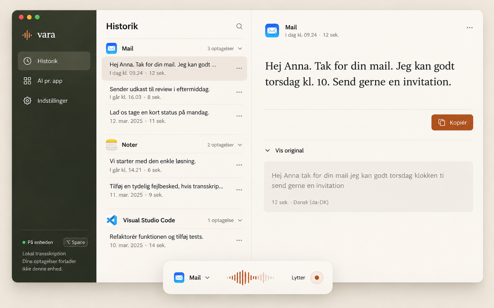

# Vara v1 — Warm precision

## Overview

Vara turns everyday speech into usable text in the app where the user is working.
It should feel like a well-made personal instrument: ready immediately, quiet
while working, and clear when something needs attention. The user selected
**the first imagegen mockup, Warm precision**, on 2026-10-23. That selection is the
visual direction for this document.

This is the canonical design system for the clean-write first release. It extends
the existing GDD interaction specification, retaining the product requirements in
[PRODUCT-SPEC.md](PRODUCT-SPEC.md) and public interfaces in [CONTRACTS.md](CONTRACTS.md).
It specifies implementation guidance; it does not claim that components are built.

### Reference and evidence

The reference establishes olive navigation, warm paper, burnt orange, a restrained
three-column workspace, app-grouped history, editorial serif reading text, fine
separators and a small floating recording surface. Its exact font, hex colors,
measurements, keyboard behavior and invisible states cannot be recovered from a
raster image. The values below are intentional implementation choices matching
that direction, not measured original source tokens.

The reference shows some expanded original text and uses “optagelser”. The release
starts original text collapsed and uses **“dikteringer”** for completed history:
there is no retained audio attachment. Generated dates, durations and app icons are
illustrative. Do not infer new features or data requirements from them.

The settings-v2 mockups extend this direction; the native desktop UI implements
their accepted settings organization. The earlier HTML interaction prototype
predates settings v2 and is not the current settings reference.

The [HTML prototype](design/index.html) implements the original visual direction with shared
components and CSS tokens generated from this file. It remains a simulation, not
evidence of native OS integration. The previous interaction study is archived.
The imagegen gallery is visual exploration. This document is the current authority
for reusable visual decisions; the GDD graph owns domain behavior.

### Principles

1. **The text is the outcome.** Give the finished text the strongest content
   hierarchy. Keep model names and diagnostics secondary until needed.
2. **Warmth comes from material and rhythm.** Paper tones, olive navigation and
   expressive reading type carry identity. Avoid decorative gradients and card stacks.
3. **One clear next action.** In a result, copy is primary; in a form, save is
   primary; during setup, continue is primary. Peer navigation stays quiet.
4. **Truthful simplicity.** Keep origin, delivery status, locality and recovery
   visible when relevant. A cleaner screenshot is not a reason to hide a failure.
5. **A desktop utility in daily use.** Dictation stays in the user's working app.
   Opening Vara is for inspecting results, making choices and recovering work.

### Scope

One warm light workspace with dark olive navigation, for macOS, Windows and Linux.
This is not a dark-mode specification; do not invert it automatically. Platform
window chrome, permission dialogs and secret storage remain native. UI copy is
Danish with an English localization boundary. No new accounts, billing, charts,
file transcription, wake word, standalone chat or editor are introduced.

## Colors

### Semantic roles

| Role | Token | Use |
| --- | --- | --- |
| Workspace | `canvas` | History/list background and settings page ground |
| Reading surface | `surface` | Result pane, inputs, dialogs and HUD |
| Recessed surface | `surface-muted` | Expanded original text and read-only supplemental content |
| Primary text | `on-surface` | Headings, body, result and active controls on light surfaces |
| Supporting text | `muted` | Timestamps, descriptions and placeholders; no reduced opacity |
| Separator | `divider` | Decorative column/row rules, not the sole control boundary |
| Control edge | `control-border` | Necessary input, secondary-button and unchecked-control edges |
| Selection | `selected` | The currently inspected history row |
| Hover | `row-hover` | Available row/secondary-control pointer feedback |
| Navigation | `sidebar`, `on-sidebar` | Dark olive primary navigation |
| Navigation selection | `sidebar-selected` | Current page; also add weight and a visible selection mark |
| Primary action | `primary`, `on-primary` | One dominant action in the active task region |
| Brand signal | `brand-signal` | Waveform brand mark on olive; not functional small text on paper |

`primary` is burnt orange, not the background of every selected item. Selection is
paper-tinted, focus is a distinct outline, and success is green. These meanings
must remain distinguishable. The brand-signal color is intentionally lighter than
the accessible orange action color. Never place brand-signal text on a light surface.

### State pairings

Use white on primary/hover/pressed. Use on-surface on all three light surfaces,
selected, and row-hover. Supporting text uses muted on those same light surfaces.
Sidebar labels use on-sidebar; supporting navigation copy uses sidebar-muted.
Both remain opaque. For disabled controls use on-disabled on disabled, not global
opacity that also dims labels and focus.

Success, warning, error and information each pair their named foreground with the
corresponding `*-surface`. Pair status text with an icon and a concrete label.
The local-ready dot on olive uses success-inverse; the label remains on-sidebar.
The dot is not sufficient to convey readiness by itself.

Focus uses focus on light surfaces and focus-inverse on olive. Use a 2px outline
with a 2px surface-colored gap. Check it against both the component edge and the
surrounding region. Decorative dividers may be subtle; essential control edges
must use control-border or another verified sufficient contrast pairing.

The color vocabulary is deliberately finite. Do not introduce blue for ordinary
links, purple for AI, or a separate accent for each originating app. Native app
icons can retain their own colors; they are identity content, not theme accents.

## Typography

### Roles and availability

| Role | Application |
| --- | --- |
| `brand` | Lowercase “vara” wordmark only |
| `heading-lg` | Main view title, for example “Historik” |
| `heading-md` | Settings group or dialog heading |
| `body` | History previews, forms, prompt editing and general UI copy |
| `label` | Buttons, app group names, important field labels and status titles |
| `caption` | Timestamps, optional counts, help and supporting status |
| `reading` | Short finished dictation in the detail pane |
| `reading-compact` | Long results or constrained detail width |
| `keycap` | Actual keyboard binding; tabular numerals where supported |
| `reading-wide` | Short finished result at viewports of 1440px and above |
| `body-wide` | History previews and navigation in the large reference composition |
| `caption-wide` | Dates/counts in the large reference composition |
| `label-wide` | Prominent copy action in the large reference composition |
| `original-wide` | Expanded original in the large reference composition |

Use system sans-serif for interaction and serif for the wordmark and finished text.
This contrast is central to the chosen identity. Do not set the whole interface in
serif. Do not use a monospaced font for ordinary transcript prose.

The stacks are fallback instructions, not evidence that each font is installed.
No remote font loading is needed. Exact glyphs and weight rendering can differ
by OS. If identical crossplatform typography later needs a bundled font, verify
its license, language coverage and metrics before replacing these roles; do not
silently depend on an unbundled commercial font or synthesize unsupported weights.

### Reading and long content

Use reading when the pane's content width is at least 440px and the selected text
is no longer than 600 characters. Otherwise use reading-compact, determined when
the result opens or layout changes. Never animate font size or change it mid-read
because an async metadata field arrived. Large reading type is appropriate for a
short dictated message; it must not turn a long transcript into a huge poster.
At viewport widths of 1440px and above, use reading-wide for short results, body-wide
for previews/navigation, caption-wide for dates/counts, label-wide for the main Copy
action, and original-wide inside the expanded original panel. Long results still
use reading-compact. This larger composition matches the chosen full-size image;
it does not enlarge all form controls or add a second user-selectable density mode.

Limit the reading measure to about 60 characters per line. Preserve paragraph
breaks, punctuation and intentional whitespace; wrap long URLs/technical tokens
at safe boundaries without changing stored text or copied content. Do not convert
a plain transcript into interpreted HTML. Finished text is selectable and read-only.

History previews may truncate after two lines. Full text, errors, prompts, field
labels and locality explanations must remain accessible without hover. Dates use
localized formats; full date/time is available on demand and to assistive technology.
Use tabular numerals for aligned times without forcing a monospace visual style.
No essential text is smaller than caption. Text scaling must increase layout height.

## Layout

### Main window and spatial rhythm

Design reference window: 1280 × 820 logical pixels. A practical desktop minimum
is 720 × 560; resizing, display scaling and accessible text scaling still require
reflow below that content width. Use logical pixels/native layout units, not raw
physical pixels. Native titlebar/safe areas are in addition to the content model.

| Available content width | Composition |
| --- | --- |
| 1280px and above | 18:33:49 navigation/history/detail tracks, with 224px / 320px / 420px minimums |
| 1040–1279px | Same track proportions and minimums; detail gutters reduce |
| 720–1039px | 184px navigation + one master/detail content surface; opening a result replaces the list with a visible back action |
| Below 720px | Labeled top navigation and one content surface; list/detail drilldown, no tiny three-column layout |

The proportional tracks refine the initial fixed-column proposal to match the
selected image: at its 1586 × 992 viewport the framed prototype starts navigation
at x=39, history near x=310, and detail near x=808. These are reference alignment
measurements, not hardcoded screen coordinates. The body uses a separate quiet
preview stage; actual native window content has no surrounding desktop padding.

At 320px effective width, content must reflow vertically without page-wide
horizontal scrolling. This is an accessibility/reflow requirement, not a promise
of a separate phone app. Keep all three navigation destinations available; labels
wrap or navigation moves to a disclosed, explicitly labeled menu. Do not shrink
the body font or replace all destinations with unexplained icons.

The selected reference uses three structural columns, not a grid of floating
cards. There is one divider between navigation/history and one between history/
detail. Columns share the window bounds. Do not put a rounded panel around each
column. Settings use the same navigation and a single comfortable form surface.

### Spacing rules

Use xs for icon/label micro separation; sm for compact groups; md for control
interiors and row gaps; base for ordinary related fields; xl between logical form
groups; xxl between major subregions. Detail pane padding is page at wide widths,
xxl below 1280px, and lg below 720px. History list side padding is base. Settings
content has xxl gutters and a readable maximum form width of 720px; narrow gutters
reduce to base. Section spacing is for major separation, not every field.

Navigation rows have a 44px minimum height, md horizontal inset and a 20px leading
icon. Window title/history toolbar is at least 72px high and grows if labels wrap.
App group headings have a 48px minimum height. History rows have a 72px minimum
height, md vertical padding and base horizontal padding; they grow for text scaling.
Use a single consistent row rhythm rather than tuning every example separately.

### Scrolling and persistence

At wide sizes, history and detail can scroll independently, with their headings
remaining in their own regions. Avoid scroll traps: focused items must scroll into
view, and ordinary reading never requires dragging a tiny custom scrollbar. At
narrow sizes use one main vertical scrolling surface. No fixed-height text containers.

A narrow detail view has “Tilbage til historik” and preserves list position, app
expansion, query and selected result. Selecting another result does not reset the
whole window. Do not steal keyboard focus merely because new dictation was saved.
Keep the HUD outside the main window's clipping region, within the current display's
safe bounds. Do not cover an active text caret or essential OS controls when avoidable.

## Elevation & Depth

Use tonal surfaces and fine rules for the permanent workspace. No shadow on
history rows, selected rows or ordinary settings sections. Hover does not lift a row.

| Layer | Visual treatment | Web-equivalent recipe |
| --- | --- | --- |
| Main app window | Native frame/shadow; plain paper content | Reference-only shadow `0 16px 48px rgba(34, 31, 23, 0.16)` if a web specimen needs an outer frame |
| Menu/tooltip | Thin control-boundary edge, soft short shadow | `0 6px 20px rgba(34, 31, 23, 0.14)` |
| Recording HUD | Surface fill, 1px divider edge, deliberate separation | `0 10px 32px rgba(34, 31, 23, 0.18)` |
| Dialog | Same surface, stronger separation | `0 20px 56px rgba(34, 31, 23, 0.22)` with a neutral scrim |

The native app must not draw a second decorative window shadow inside an existing
OS frame. Do not reproduce the imagegen background texture, simulated sunlight,
beige desktop wallpaper or ambient vignette inside the actual application.

Layer order: content, sticky region headings, menus/tooltips, modal scrim/dialog.
Native HUD and OS windows use platform window policies, not a guessed universal
z-index. A background recording indicator must never visually or semantically
cover a modal's essential controls. Closing a dialog restores focus to its invoker.

## Shapes

### Corner roles and borders

Use row radius for selected/hover history shapes and keycaps; control for buttons,
fields and navigation selection; panel for original text and notices; window for
large transient dialogs where the OS allows; hud for the floating recording
surface. Pill radius is for toggles and small status chips, not all buttons.
Window corners themselves follow platform chrome when native-managed.

Default edge width is 1px. Focus/invalid cues are 2px but must not change layout:
reserve the geometry or draw an inset/outer ring. Permanent column separators use
divider. Form fields and essential control silhouettes use control-border.

### Icons, identity and app artwork

Use one consistent 20px line-icon family with 1.75–2px optical strokes. Small
supporting icons can be 16px; brand waveform has a 24px optical box. Icons align
optically with labels and never replace the only available label for a critical
state. Choose the final icon library during implementation, not by mixing assets
from several libraries. Decorative icons are hidden from accessibility trees.

Use a small burnt-orange waveform on olive beside the lowercase serif “vara”.
This is a design description, not a delivered vector asset. Do not trace a fuzzy
raster logo into production or treat imagegen's icon details as licensed artwork.

Originating app icons are native installed-app artwork where available, 24px in
headers and 20px in compact rows/HUD. Preserve aspect ratio and do not recolor.
Missing/unreadable icons use a quiet monogram tile on surface-muted with on-surface
text and the visible full app name. The icon cannot be the only app identifier.
No stock illustration, 3D object or background image is needed for v1 screens.

## Components

### Component ownership and shared contract

Reusable view primitives live in Experience; business decisions come from GDD
interfaces. Widgets render outcomes, never infer success from a closed dialog or
an elapsed timer. The inventory below defines visual/interaction contracts, not
a requirement to create one Rust crate or class per component.

| Component family | Used by | Relevant GDD interfaces |
| --- | --- | --- |
| App shell, navigation, history groups/rows, reading pane | Main window | `action.history`, `action.delete_result`, `action.retry_delivery` |
| Fields, switches, choices, form sections | App AI and Settings | `action.app_rules`, `action.presets`, `action.processing_policy`, `action.strict_local` |
| Shortcut recorder, input device, permission row | Setup and Dictation settings | `action.configure_shortcut`, `action.input_device`, `action.permissions` |
| Engine readiness, model progress, key/endpoint/CLI setup | Connections and onboarding | `action.recommended_setup`, `action.advanced_engines`, `action.credentials`, `action.cli_processing` |
| Session HUD, recovery task, notices | Everyday dictation and recovery | `action.session_feedback`, `action.cancel`, `action.retry`, `action.recovery_audio` |

All essential controls have at least a 32 × 32px hit area; normal controls target
40px height and icon-only controls 36px square. Compact glyphs can remain visually
smaller inside that hit area. Use at least 44px targets in touch-oriented or
coarse-pointer layouts. Controls grow for localization/text scaling.

### Shared state precedence

| Combined state | Required result |
| --- | --- |
| Selected + hover | Keep selection fill; use a subtle edge/weight cue, not ordinary hover replacement |
| Selected + keyboard focus | Keep selection and add the complete focus ring |
| Invalid + focus | Keep error message/error edge and add a distinct external focus ring |
| Busy + focused | Keep focus in place and stable action geometry; announce progress once |
| Disabled + explanation | Prevent activation, retain legible label, place reason nearby; no tooltip-only prerequisite |
| Background window | Retain readable selected row; avoid presenting it as keyboard-focused |
| High contrast/forced colors | Preserve OS focus/selection semantics; custom fills may yield to user colors |

Do not apply global opacity to whole components. Related YAML state entries do
not imply inheritance, event handling or CSS pseudo-selectors; implement the full
state rules explicitly. A static surface does not gain hover just because it has
rounded corners. Hover styling signals something the user can actually activate.

### 1. App shell and native window chrome

**Anatomy:** native titlebar, olive navigation, history/master region, reading/
detail region. Only the content regions belong to the design system. On macOS use
native traffic lights and titlebar behavior; Windows and Linux use their actual
window controls. Do not ship painted macOS window buttons on other platforms.

**Behavior:** opening Vara returns to the relevant history context after onboarding.
Window focus is distinct from the target focus used for automatic dictation delivery.
Opening a main window during dictation must not make the delivery contract assume
the old target is still active. Resizing follows Layout; panes must not clip controls.

### 2. Sidebar navigation and readiness footer

**Anatomy:** brand block, three labeled destinations with leading icons, flexible
space, a fine separator, local/provider readiness and actual shortcut keycap.
Destinations are “Historik”, “AI pr. app”, “Indstillinger”. No extra destination for
provider catalogs, diagnostics, statistics or upgrade offers.

**Visuals:** sidebar-item tokens; row gap sm. Selected page uses sidebar-selected,
label weight and a 2px brand-signal leading mark with safe inset. Hover uses
sidebar-hover. Keyboard focus uses focus-inverse, distinct from the leading mark.

**Behavior:** use ordinary page-navigation semantics; selected means current page.
Do not apply tablist arrow-key rules to the entire app navigation. Each destination
is keyboard reachable and exposes its current-page state. Narrow layout keeps
visible labels or an explicitly named navigation menu.

**Footer:** show “På enheden” only when the relevant actual engine location is
on-device. If audio and selected text destinations differ, say so explicitly, for
example “Lyd: på enheden · Tekst: cloud”. Optional remote configuration alone does
not mean this session used cloud. Show actionable not-ready/permission state when
needed. The footer keycap is the real binding; “⌥ Space” in the mockup is illustrative.

### 3. View header and search

**Anatomy:** view title, quiet search action or labeled search field if included,
optional contextual status. No greeting, hero paragraph or large recording CTA.
Search is the small convenience already proposed for history, not a new release
dependency. Its empty/filter/error states must be defined if implemented.

**Behavior:** an icon-only search action is labeled “Søg i historikken” and opens/
focuses the field. The field has a persistent accessible label, clear-query control
and nonintrusive result count. Search looks through original and processed text.
“No matches” differs from “no history”. Clearing restores the prior app grouping.
Do not move focus into a result automatically on each typed character.

### 4. App group header

Resolve app artwork from the installed/running app by its OS identity. On Mac,
use the actual NSWorkspace app icon, preserving its colors, proportions and alpha.
Share the artwork across history, reading pane and app preferences. Fetch locally
and asynchronously; a missing/uninstalled app uses its initial as a monogram.
Do not guess an icon from the app name or fetch logos from external services.

**Anatomy:** native icon/monogram, full originating app name, optional actual count,
expand/collapse affordance. Label count as “dikteringer”; no audio-play implication.
Use label type for name and caption for count. Icons and counts do not compete
with the name. The heading itself has no rounded card background.

**Behavior:** a header can collapse only its group's list. Use a real button with
expanded state and a descriptive label, such as “Mail, 3 dikteringer”. Collapse
must not destroy data, change sorting or invalidate the active result. Keep the
selected result visible until another result is chosen; if its group is collapsed,
the detail can remain and selection is indicated on the group header.

Group order follows each app's newest result; rows are newest first. Preserve
meaningful invocation-app association even when focus changed later. A renamed or
uninstalled app retains its stored label and fallback icon rather than losing history.

### 5. History row and direct actions

**Anatomy:** one/two-line finished-text preview, localized date/time beneath,
optional delivery/processing indicator, separate copy and delete icon buttons. No automatically
generated title or artificial summary is required. Preview processed text if it
exists; direct/fallback shows original. Do not rewrite previews for style.

**Visuals:** history-row states, natural 72px minimum rhythm. Selected fill is
selected with no shadow. Quiet 1px separators between ordinary rows; selection
rounding must not shift text alignment. On error/manual-ready, include a small
icon and explicit status such as “Klar til indsættelse”. Successfully inserted
results can use quieter status; absence of a warning is not confirmation.

**Behavior:** selecting opens detail immediately; Tab/Enter/Space work through
native semantics. Structure a semantic list item with a primary open/select
button and a sibling shared action group containing copy and trash icons. Give
each action an accessible Danish label and tooltip, and a 36px target. Copy acts
on the clicked row immediately, preserving selection and without opening a dialog.
Delete opens the existing destructive confirmation directly. Do not use an extra
two-option overflow modal or nest buttons inside the selection button. Use the
same action component beside the selected result. Do not adopt an ARIA listbox
while also nesting arbitrary controls in options. Keyboard focus is not
silently moved when an arriving result changes the list.

**Content:** long app names may wrap; previews truncate, full content remains in
detail. A selected deleted result moves selection to an adjacent existing item
or shows the empty-detail state without throwing focus to the top of the window.
Pagination/virtualization must not imply a history count cap or lose accessible names.

### 6. Result reading pane

**Anatomy:** origin app identity and actual date/time; delivery and processing
status when relevant; finished text; primary copy action; optional original
text disclosure; quiet retention/locality metadata and secondary actions.
The short message uses serif reading type; UI labels remain sans-serif.

**Content:** finished text first, selectable without entering an editor. Do not
add a title unless explicitly stored. Direct mode has one representation and no
empty “original” comparison. Successful AI shows both stored versions; AI failure
labels the original fallback. Do not infer processing from different punctuation.

**States:** no selection gives a small “Vælg en diktering” instruction. Loading
keeps the layout stable and announces loading; storage failure has an inline
retry and must not masquerade as an empty database. Unknown/failed delivery keeps
text fully available and uses a persistent notice with manual copy.

**Copy:** “Kopiér” explicitly copies the finished text and may replace the clipboard,
as deliberately requested. “Kopieret” feedback is truthful and announced only after
success. Failure leaves a visible “Kunne ikke kopiere” and a retry path. Automatic
insertion has different clipboard-preservation rules and is never simulated by
pressing Copy in the UI. Do not add mandatory approval before automatic AI delivery.

### 7. Original-text disclosure

**Anatomy:** chevron, “Vis original”, expanded inset text region. Default collapsed;
expanded label can be “Skjul original”. Expanded state is exposed semantically.
Use original-panel tokens, sans-serif body, generous line height and readable muted
text. No diff engine, side-by-side editor or audio player is required.

**Behavior:** Enter/Space toggles with focus preserved. Expanded content is
selectable. Preserve open state while inspecting that result; opening a different
result starts collapsed. Large originals expand naturally in the pane scroll area.
If explicit original-copy is provided inside the disclosure, label it “Kopiér
original” so it cannot be mistaken for copying the finished text.

### 8. Buttons, links and icon actions

**Primary:** burnt-orange fill, white label, md vertical/base horizontal padding,
40px minimum height. Use primary-hover and primary-pressed without geometry shifts.
One primary action per active task region; a modal has its own task context.

**Secondary:** surface/on-surface, 1px control-border edge; hover row-hover; pressed
selected. Quiet text actions use primary on light backgrounds and visible hover
underline. Destructive actions use error/error-surface, never ordinary orange.

Destructive hover/pressed retains its error color pair and adds an error-colored
edge without geometry change. Do not introduce a red glow.

**Icon-only:** 36px target with 20px glyph, accessible action name and a tooltip.
Every critical/error recovery action has visible text as well. Focus uses the
shared ring. Disabled uses actual disabled semantics plus an explanation when
nonobvious. Busy retains action width, adds an explicit label such as “Gemmer…” and
prevents duplicate submission. Failure restores the action and retains entered data.

### 9. Field, textarea and validation message

**Anatomy:** persistent label, optional helper, control, optional error. Label/control
gap xs; helper/error gap xs. Input uses input-field, control-border 1px and md inset.
Prompt textarea starts at 144px minimum height, grows or scrolls internally without
hiding its label, and uses body sans-serif. It is a prompt editor, not rich text.

**States:** default, hover, focus, filled, read-only, invalid, disabled and saving.
Invalid adds error edge and specific correction text while keeping entered text
on the standard surface. Read-only differs from disabled: selectable contents,
explicit explanation, no misleading editable caret. Placeholder is muted and
never substitutes for a label. Never show raw secrets in validation messages.

Validate on submit and revalidate an already-invalid field after edits. Do not
show an error before the user has had a chance to enter data. On multi-field
failure, focus a short error summary with links or the first invalid field for a
small form. Associate helper/error text and invalid state with its control.
Unsaved form edits survive validation/network errors and ordinary window resizing.

### 10. Select, switch, radio and checkbox

Use native/proven accessible controls. A select shows the saved choice and a
persistent label. Options include meaningful location/readiness information;
provider/model names are values, not additional visual accents. Missing/unavailable
options remain identifiable with a reason and configuration path.

A switch is for a boolean such as “AI-bearbejdning for Mail”. Track: 36 × 22px;
thumb: 18px, with 2px inset. On uses primary, off uses control-border; thumb is
white. Text states “Til”/“Fra” or a clear associated description complement color.
The entire label is clickable; keyboard Space toggles. In forms the switch changes
the draft and the explicit Save commits it; it does not secretly save one field.

Checkboxes are for opt-ins such as timed cleanup; radios for mutually exclusive
choices such as local/cloud or hold/toggle. Standard visible box is 18px within
a larger target, with a check/dot in addition to color and appropriate semantics.
Choice cards have surface fill, control-border outline and selected mark; do not
make them oversized marketing cards. Arrow keys follow native radio/select behavior.

### 11. Shortcut recorder and keycap

Keycap is a representation of the actual active binding, not a general clickable
button style. On paper, use surface-muted/on-surface with control-border; on olive
use shortcut-keycap tokens. At least sm horizontal and xs vertical inset, and no
clipped modifier glyphs. Show platform-appropriate names, for example “⌥ Space” on
Mac versus the binding the user actually chose on Windows/Linux.

The recorder has current binding, “Skift genvej”, a listening state, explicit cancel
and conflict feedback. It captures key combinations rather than expecting users
to type symbolic syntax. Ignore repeated keydown. Test/register the new binding
before replacing the old one; conflict preserves the previous working shortcut.
Escape leaves recorder mode without changing it. A valid shortcut remains visible
outside the recorder. Provide an in-app start/stop route when global binding is unavailable.

### 12. Locality, readiness and status chip

Use small icon + text, optionally a soft semantic background; no all-caps capsule
for every metadata field. “På enheden”, “Cloud” and “Ikke klar” describe different
facts. Connection configured, authenticated, model installed and runtime ready
are separate states; never display green ready based only on a filled key field.
Unknown actual processing location remains “Ukendt”, not assumed local.

Expose audio and text destinations independently when they differ. An installed
CLI can use a remote model; LAN/custom endpoints are not on-device inference just
because a process runs locally. In strict on-device mode, incompatible options
show a specific conflict and preserve current settings. Do not invite a silent cloud
fallback with a generic “Fortsæt” button.

### 13. Inline notice, toast and tooltip

Notices use the appropriate notice tokens, a semantic icon, concrete message and
optional named action. Examples: “Fokus ændrede sig. Teksten er klar til manuel
indsættelse.” and “AI-bearbejdningen fejlede. Originalen er bevaret.” Keep these
inside the affected result/settings region until resolved; critical failures do
not disappear after a timer. Explain pending audio cleanup without claiming deletion.

A toast is for noncritical acknowledgments such as a saved preference or successful
copy. Use a compact surface with short text and a polite status announcement; it
must not steal focus. Avoid a toast queue for every processing stage. No timed
toast is the only route to recovering content or understanding a failed action.
Do not offer Delete Undo unless data actually remains recoverable under the deletion
contract; the old prototype's in-memory undo is not a promised production feature.

Tooltip supplements an icon label, appears on hover and keyboard focus, dismisses
with Escape and never contains required instructions or actions. On narrow/touch
layouts, required information remains inline. No tooltip over the active text caret.

### 14. Temporary recovery task

A recovery task is distinct from completed history. Show it above the affected
history list or in a clearly labeled recovery region, not as an audio attachment
in a completed row. Anatomy: origin app, failed stage, exact remaining expiry when
known, “Prøv igen” and “Slet optagelse”. No audio playback.

States: retryable, retrying, expired/deleting, cleanup pending and resolved. Retry
has one owner; cancel/expiry invalidates late work. Display expiry from the original
capture deadline, never a fresh “24 timer” on each retry. Expired audio is removed
from offered recovery even if physical deletion is pending; the pending cleanup
status remains truthful. Successful retry deletes audio and uses ordinary delivery
checks, never assumes old focus is still current.

Interrupted private text has a separate recovery explanation and explicit manual
use choice. Do not show it as an already completed/inserted history entry or
silently replay it on restart. Refer to the GDD lifecycle contract for commit order.

### 15. Recording and processing HUD

**Anatomy:** origin icon/name, clear stage label, optional waveform/progress,
processing destination when relevant, cancel; explicit stop action when required
for toggle/in-app control. Preferred size is about 440 × 64px with base inset,
sm/md internal gaps; allow width to adapt between 280px and 520px and increase
height for localized labels. Do not squeeze required information into a fixed capsule.

**Visuals:** recording-hud tokens, soft HUD shadow, orange waveform on paper.
Use primary for active signal strokes; quieter segments are decorative only.
The displayed amplitude must reflect actual input if represented as a level meter.
No endless decorative pulse presented as proof of microphone activity.

| Domain stage | Copy example | Available action / guarantee |
| --- | --- | --- |
| Listening | “Lytter · Mail” | Release hold binding or explicit “Afslut”; “Annuller” cancels |
| Speech recognition | “Finder dine ord” | Cancel; selected audio destination remains visible |
| Text processing | “Tilpasser teksten” | Cancel; general/app-prompt and actual text locality remain inspectable |
| Delivery complete | “Indsat i Mail” | Brief passive confirmation only after confirmed handoff |
| Changed/unknown focus | “Klar til indsættelse” | Saved text, deliberate manual use; no automatic retry |
| ASR failure | “Kunne ikke transskribere” | Explicit recovery while unexpired |
| AI failure | “Originalen er brugt” | Normal delivery rules; inspect result/fallback status |
| Cancellation | “Annulleret” | No late publication; AlreadyCommitted is reported honestly |

A decorative arrow next to “Mail” in the reference must not become an app picker
that retargets an active session. Origin is snapshotted. The HUD is nonactivating
where platform capabilities permit. A click on it must not pretend unchanged
focus if the OS actually changed the target. Unsupported safe target verification
falls back to manual-ready, not risky best-effort paste.

Status announcements follow real stage transitions without repeating live levels.
Escape follows the cancellation contract when the session owns that shortcut;
never globally swallow Escape from other apps without valid OS registration.
Reduced motion removes decorative transitions while retaining readable stage text.

### 16. Context menu, tray menu and dialogs

Use a native menu where possible, with the theme expressed only where supported.
Menu items have visible labels, 32px minimum target height, sm horizontal inset,
focus/hover selected background and correct native keyboard behavior. Separate
Delete visually from ordinary actions. The tray/menu-bar entry gives access to
open Vara, dictate/start-stop as appropriate and choose direct/general AI for the
next session without mutating app defaults. Do not turn it into a provider catalog.

A dialog contains one task, heading, labeled content, inline feedback, primary
and secondary action. Standard width is 480px, expanded form width up to 600px;
cap it to viewport minus 32px and permit internal vertical scrolling. Small screens
use a full-width sheet within safe margins. Scrim can use `rgba(37,37,31,0.28)`.
Native modal semantics manage focus, dismissal and background inertness.

Confirmation is for an actually destructive consequential action, not successful
transcription/AI output or every preference edit. Individual result deletion can
use a small confirmation naming that result, with “Slet diktering” / “Behold”. Do
not add a second confirmation. Deleting must remove original and processed text
together; never claim physical deletion before the domain confirms it.

### 17. Empty, loading, offline and failed surfaces

| State | What remains visible | Next step |
| --- | --- | --- |
| Empty fresh profile | Calm explanation and actual shortcut; no fabricated rows | Guided setup or a real trial if already ready |
| No search matches | Query, app/filter context and “Ingen match” | Clear/change query |
| Loading history | Existing results if available, stable header, “Henter historik…” | Wait; no fake success/data |
| Storage unavailable | Available in-memory text and clear unsaved state | Deliberate copy/retry; no automatic delivery claim |
| Local model missing | Selected local choice and requirements | Download/retry local setup |
| Offline with local engine ready | Actual local readiness | Keep local dictation available |
| Remote unavailable | Chosen provider and actionable error | Retry or deliberately change engine; no automatic upload/fallback |
| No result selected | Small selection instruction | Choose a history row |

Empty surfaces use typography and whitespace, not stock illustrations or enormous
calls to action. Loading can use a small spinner plus text; do not rely on animation
to communicate work. Keep user input/results during refresh failures.

### 18. Settings and app preferences

The user approved the settings-v2 imagegen mockups on 2026-10-24:
[Dictation](design/mockups/settings-v2/01-diktering.png),
[Models and keys](design/mockups/settings-v2/02-modeller-og-noegler.png), and
[Privacy](design/mockups/settings-v2/03-privatliv.png). These extend Warm precision
with an editorial settings layout. The images demonstrate optional AI enabled;
direct transcription remains the default. Illustrated model selections, statuses
and retention periods must never overwrite a user's saved configuration.

**Information architecture:** keep exactly three settings destinations:

| Destination | Purpose and content |
| --- | --- |
| Diktering | Complete invocation flow: recording controls, speech model, optional text AI, instructions and OS permissions |
| Modeller og nøgler | Local model downloads, stored-key status/tests, editing model names/custom endpoints, and optional installed CLI connections |
| Privatliv | Strict on-device rule, actual default processing destinations, text-history retention, and fixed audio deletion/recovery policies |

Choose both active models on Diktering, never on the model-management page. First-use
cloud preference leads directly to the speech selector on Diktering. Local defaults,
all provider choices, custom endpoints, CLI adapters, one-shot processing and app
rules remain available. No provider is silently selected, enabled or removed.

**Shared settings section:** `settingsSection` composes a semantic section, a heading
and short description, and a control/content region. On wide windows use a left
explanation column and wider right form column, separated by 32px. The left column
has a 180px minimum; the right column permits shrinking/wrapping. Section padding
is 26px vertically, with a single divider and no card background. Download/provider
management uses the same component's full-width variant so aligned rows remain
comparable. Below 760px stack the explanation above controls. The recording grid
uses two columns when space permits; below 540px all fields and processing choices
stack. Keep native controls, persistent labels and readable text; scroll vertically
rather than compressing controls to fit a screenshot.

The settings page title uses the existing serif family at the reading-wide size
(36px), weight 500 and line-height 1.15; use 30px below 540px. Settings-section
headings use the same family at 24px, weight 500, line-height 1.25. This is an
intentional display-heading exception for settings, matching the accepted mockups;
field labels, control contents, status text and navigation retain the sans-serif
roles. Preserve the existing olive/paper/orange tokens and focus treatments.

**Diktering, in order:**

1. Optagelse: activation style, configurable shortcut, microphone and language.
   Preserve side-specific shortcuts and all existing key combinations. Parakeet
   uses automatic language; switching back to a model with language choice restores
   the pending language selection. Native permission controls remain reachable
   in a clearly named Tilladelser section on this page.
2. Tale til tekst: shared model selector labeled Transskriptionsmodel, followed by
   true locality/readiness and a contextual action when setup is missing.
3. Efter transskription: native radio group with Behold transskriptionen and
   Bearbejd med AI. The latter reveals Tekstmodel and Instruktioner til AI. Hidden
   fields retain their values; switching mode never enables AI merely because a
   prompt exists. A visible note explains app overrides and offers Administrer apps.

**Shared model picker and feedback:** speech, general text and app text selectors
use the same model control. Show configured model identifiers for remote/custom
engines alongside their labels. Display Cloud, on-device, LAN or unknown locality
explicitly. Ready/missing/download progress and credential status are distinct.
Offer Hent model/Annuller, Tilføj nøgle/Administrer nøgle, Test nøgle, or Kontrollér
CLI only where applicable. Key setup and downloads must work in context while
preserving an unsaved form. Only required dependent controls update on a change;
do not rebuild a hint button when a textarea loses focus. The strict-local rule
disables remote choices but never silently substitutes a different model.

**Modeller og nøgler:** align each local-model row into identity/size, actual
installation/progress state, and its action. Provider rows similarly align name
and capability, metadata-only key status, and key-management/test actions. Stored
and API-tested are separate states. Keep named disclosures for Egne endpoints og
modelnavne and Installerede CLI-værktøjer. Custom endpoint locality, optional keys,
model-name editing and CLI checks retain their existing behavior.

**Privatliv:** Behandling contains Kun behandling på denne enhed and a truthful
summary of default speech/text locations, including an app-override explanation
when relevant. Warn if a pending strict-local rule conflicts with selected engines
or enabled app rules; saving remains subject to domain validation. Historik uses
an explicitly labeled retention dropdown defaulting to Indtil jeg selv sletter,
preserving custom positive periods as well as standard options. Deletion removes
both original and processed text. Lyd contains shared explanatory policy rows,
not toggles: delete after successful transcription; retain failed audio for no
more than 24 hours; delete earlier on successful retry or user deletion.

**AI pr. app:** remains in primary navigation. The explicit Brug egne AI-indstillinger
switch enables that app's own instructions and text model; off means follow the
global standard, not force direct transcription. Conditional fields retain their
values. Reuse the same text-model picker and locality/setup feedback. Preserve
per-app model/prompt overrides, default inheritance and existing session precedence.

**Save and recovery:** use a quiet Fortryd ændringer followed by primary Gem
indstillinger in a sticky footer, right-aligned on wide screens. Show pending edits
in text; wrap the footer at narrow widths and keep focus scroll margins above it.
Provider keys and downloads keep their explicit immediate actions; the footer does
not pretend to save these operations later. Navigation with unsaved edits retains
the existing stay/discard guard. Failed saves preserve the draft and prior working
preferences. Key dialogs, status checks, downloads and progress events must not
discard unsaved models, instructions or recording preferences. Changes affect
future invocations, never an already frozen dictation plan.

### 19. Engine row, model download and connections

Engine row anatomy: speech/text capability, provider/model name, actual locality,
readiness label, one relevant action. Default local setup is prominent in its
context. Cloud models are selectable alongside local models on Diktering, with explicit
locality. Setup operations belong to Modeller og nøgler and contextual model
feedback; custom endpoints and installed CLIs use their named disclosures. Do not
turn these controls into a first-use comparison marketplace.

A model download shows model name, real transfer size/storage requirement, textual
progress and Cancel. Progress track uses surface-muted with control-border when
needed; fill uses primary. Only show a percentage when a reliable total is known.
Indeterminate state says “Henter model…” rather than inventing a countdown.
Verify/load before “Klar”; partial/cancelled/failed downloads never show ready.
Keep retry actionable and prior valid installs intact.

API-key form: named provider, password field, show/hide if needed with labeled
state, explicit validation/save action and specific error. Clear sensitive input
when closed, successfully stored or after a failed save. Reopening shows stored-key
status and an empty replacement field; never retrieve or display a stored key. No key in diagnostics, transcript or UI
logs. Storage succeeded and provider validation succeeded are different messages.

Custom text endpoint: name, URL, model, optional key and actual locality. LAN is a
separate choice from on-device. CLI row identifies installed/supported/authenticated
status and genuine tool login route; it does not fabricate a Vara login or promise
subscription voice. Provider names are content and do not change component styling.

### 20. First-use setup and permission row

A compact flow: welcome/local choice → model preparation → actual permissions and
shortcut test → real trial → history. Use the same form/action/readiness components,
not a separate promotional design language. One visible current step and clear back
route; no mandatory account/API key on the local path. Optional cloud is a deliberate
alternative with its own provider/key prerequisites.

Permission row has capability name, actual state, short purpose and one action
such as “Giv adgang”. Do not show green permission from clicking an explanatory
button; use the OS result. Denied/unsupported state has an accurate help path.
The user chooses/tests a binding without terminal setup. Trial completion requires
an actual result; a sample sentence, downloaded model or saved key alone is not
first success. Fake downloads/permissions and demo controls never ship as real status.

### Motion and feedback timing

Control color/focus transitions: 120ms ease-out. Disclosure/pane transitions: at
most 160ms, no horizontal slide that delays reading. No bounce, spring overshoot,
parallax, typing animation or staged reveal in the daily utility. Do not animate
a completed transcript word by word. Reduced motion makes nonessential transitions
immediate and replaces moving waveform/progress decoration with stable status text.
Real recording levels/progress remain informative without being the only status cue.

Routine copy/save acknowledgment may last about 3 seconds with a polite announcement;
errors, manual-ready states and recovery tasks remain discoverable until resolved.
Timeouts and capture/provider deadlines come from the domain, not animation timing.
Never delay cancellation or disable an available recovery action for visual polish.

## Do's and Don'ts

- Do keep the olive navigation and warm light working surfaces in the selected direction.
- Do use serif intentionally in wordmark and finished reading text; keep controls sans-serif.
- Do use one burnt-orange primary action for the active task, with quiet peer navigation.
- Do keep app identity, real locality and delivery uncertainty understandable.
- Do implement original/processed text as one coherent history result, with no audio player.
- Do reuse the named components and complete compound states before introducing new variants.
- Do preserve entered text, keyboard focus and working preferences through failures.
- Do let native window controls, OS permission UI and accessibility settings stay native.
- Don't copy raster text/icons, wallpaper lighting or screenshot texture into production.
- Don't call completed history “optagelser” in a way that implies stored audio.
- Don't add automatic summaries, generated titles, chat, dashboards or other new features from visual examples.
- Don't use tiny low-opacity metadata or a subtle divider as the only essential control boundary.
- Don't add a compulsory AI preview, stealth cloud fallback or paste into changed focus.
- Don't invent readiness, successful copy, confirmed insertion, permission or deletion from UI timing.
- Don't repaint the older prototype and claim its behavior proves native crossplatform acceptance.

## Accessibility and content acceptance

This section is a design acceptance target, not a claim of implemented conformance.
Functional text pairs should meet 4.5:1; important control/focus/state cues should
meet 3:1 against their relevant adjacent surfaces. Check actual composites rather
than assuming opacity or a palette name establishes contrast. Decorative edges
are not a substitute for a visible control boundary.

Keyboard routes cover navigation, result selection, original disclosure, copy,
settings edits, validation recovery, dialogs and recording alternatives. Preserve
logical order across reflow, semantic names/expanded/selected/invalid states and
focus return. Provide a skip-to-main route in web realizations and equivalent
native navigation landmarks. Screen readers get stage changes, not waveform frames.

Stress content with: Danish/English UI, 40-character app names, absent native icons,
multiline errors, 10,000-character dictation, long URLs/code identifiers, zero results,
many app groups, unknown provider location and failed clipboard/storage operations.
All required information remains readable with 200% text sizing, narrow reflow,
reduced motion and high-contrast settings. Never fix overflow by reducing font size.

Use direct Danish copy: “Kopiér”, “Gemt”, “Prøv igen”, “Slet diktering”, “Originalen
er bevaret”. Say what happened and what the user can do. Avoid “Noget gik galt”
without a useful next step, unexplained error codes, jargon about adapters/generations
and human blame for missing permissions. Do not leak transcript/prompt/key content
into technical diagnostic notices.

## Screen composition and verification

| Surface | Composition | Acceptance walkthrough |
| --- | --- | --- |
| History | Shell → grouped history → reading pane → original disclosure | Filter/select an app; inspect processed/original; direct result has one representation; copy and delete have truthful outcomes |
| App AI | Shell → app selector → explicit enablement → prompt/engine/locality → Save | Enable for one app, save, revisit, reject invalid draft without losing saved preference |
| Dictation settings | Shell → activation/input → binding recorder → general prompt | Choose hold/toggle, conflict-test a new binding, preserve prior binding on failure |
| Settings | Diktering → both model choices and optional text processing; Modeller og nøgler → setup; Privatliv → locality and retention | Conditional drafts, app overrides, contextual recovery, key stored versus tested and all existing providers remain available |
| Privacy | Shell → text retention opt-in → separate failed-audio policy | Indefinite by default; period has units; failed-audio deadline stays fixed |
| First use | Compact guided setup using shared primitives | Local path needs no terminal/key; real permissions, shortcut and successful trial gate completion |
| HUD/recovery | Native nonactivating status + persistent recoverable outcome | Direct/app/general AI, changed focus, ASR retry, AI fallback, cancellation and late completion follow domain rules |

Before calling an implementation faithful: compare at least History, App AI,
Connections, a permission failure and each meaningful HUD stage against this
system. Check wide three-column, intermediate drilldown and narrow stacked layouts;
keyboard-only operation; serif fallbacks on each target; and the combined state
matrix. A still image can confirm visual composition, not OS insertion, clipboard
formats, credential storage, audio expiry or crossplatform runtime behavior.

## Maintenance and GDD boundary

Use the frontmatter as interoperable DESIGN.md alpha tokens. Borders, shadows,
layout formulas, motion, native behavior and state transitions are specified in
prose because they are not full core token properties. An exported color theme
alone does not implement this component system. The prototype generates `design/styles/tokens.css` from this frontmatter using
`design/scripts/generate_tokens.py`; `--check` detects drift. Component composition,
styles, fixture data and session behavior are separate files under `design/`.
See `design/README.md` for the maintenance boundary and executable flow checks.

The selected visual direction is a user decision; the detailed tokens and component
rules are the agent's implementation specification within that direction. Do not
claim the user approved every individual state or that a trusted GDD screen-readiness
review has occurred merely from selecting an image. Keep required review/runtime
evidence distinct from this specification.

Changes to this file require updating its hash-pinned GDD source, snapshot and
current revision-bound records. Preserve previous artifacts in reports/history.
Existing prototype flow evidence applies to its recorded HTML hash, not automatically
to future restyling or native widgets. This document supersedes the short first-design
note; it does not introduce a second competing palette or change the accepted v1 scope.

### Token validation notes

The official DESIGN.md CLI 0.4.0 checks the standardized frontmatter. Its four
intentional orphan-color warnings are `brand-signal`, `focus`, `focus-inverse`
and `success-inverse`: they are used for the brand/selection mark, focus outlines
and readiness indicator defined in prose. Those roles have no standardized
outline/icon property in core component tokens. They are retained deliberately,
not hidden through fake component entries or unsupported property names.

## File transcription — approved direction, 2026-10-25

The Transskribering tab follows the approved `design/mockups/transcription`
import/editor references and `TRANSCRIPTION-SPEC.md`. Reuse the existing global
sidebar, mark, button/icon-button, field, notice, empty-state and dialog primitives.
UI headings use the existing system sans-serif roles; serif text belongs to the
reading surface. Mockup font/logo variations do not introduce a second brand.

### Components and compositions

- **Import composition**: one drop/file-picker area, compact selected-file rows
  with individual removal, a model/language field pair and one explicit start
  action. Place processing destination and playback-copy retention before start.
  Show recent documents below. Import does not begin merely by selecting a file.
- **File row**: document icon, title, language/duration/stage; direct cancel while
  queued/running, direct delete otherwise. Active row uses the existing selected
  beige. Errors appear in the selected document with retry. Never invent progress
  percentages; show actual processed audio duration or an indeterminate stage.
- **Library/editor composition**: olive global navigation, paper library with
  search/add, ivory reading pane with title/rename, save status, copy/delete and
  primary export. Reflow into stacked panes at narrow widths with a complete
  route back to import and the document list.
- **Transcript segment**: narrow speaker/time margin and spacious serif paragraph.
  Speaker names are editable only when speaker data exists. Untimed text remains
  readable; do not draw invented speaker labels or word buttons.
- **Timed word**: inline, transparent native button styled as normal transcript
  text. Hover is subtle; current playback word uses pale peach with burnt-orange
  accent. Preserve text selection for playing a passage. Word times are estimates.
- **Editing state**: an accessible serif text area with autosave feedback. Keep
  the source transcript separate; explain that changed text requires alignment.
  Failed saves retain the draft. Copy/export can recover that current draft; operations requiring durable state wait for a successful save.
- **Player**: fixed below the reading pane, with rewind/play/pause/forward,
  elapsed/total time, a keyboard-operable seek control and playback speed. Any
  waveform is computed from actual audio amplitude, never decorative fake data.
- **Optional AI pane**: text-model field, persistent prompt label, visible processing
  destination and explicit run/cancel. Show AI output separately from the timed
  transcript. Original and corrected text are retained.
- **Export dialog**: named format and version fields, explicit save action. TXT,
  Markdown and full-document JSON work without word times. SRT/VTT require actual
  timing; edited text cannot silently borrow the original's timestamps.

File documents have their own library; app-grouped dictation history and its
recording HUD remain unchanged. The sidebar's shortcut status explicitly refers
to dictation while this tab is open; it must not contradict a file's cloud choice.
Native opening/saving uses platform dialogs. Original files are never deleted by
library deletion. Missing playback media is a recoverable state with readable text.

### Optional local speaker labeling — Who

Add “Find talere” as a quiet action in the transcription editor. Reuse the
existing dialog, status/notice, buttons and editable speaker/time margin. The
Who dialog shows explicit local processing, supplier/model/version, attribution,
license link and SDK usage metadata before download/use. Download/preparation
and inference are indeterminate stages with a direct cancellation action.

Keep the existing transcript and corrections readable throughout. Successful
labeling opens the annotated original; corrections are retained. A native
`details` disclosure “Talerintervaller · Who” exposes actual overlapping intervals
and uses the same speaker rename and seek buttons. Untimed transcripts show
intervals without fabricated word assignment. Errors or zero detected speakers
explain the limitation and keep prior data. No extra global navigation or new
visual language is introduced.
