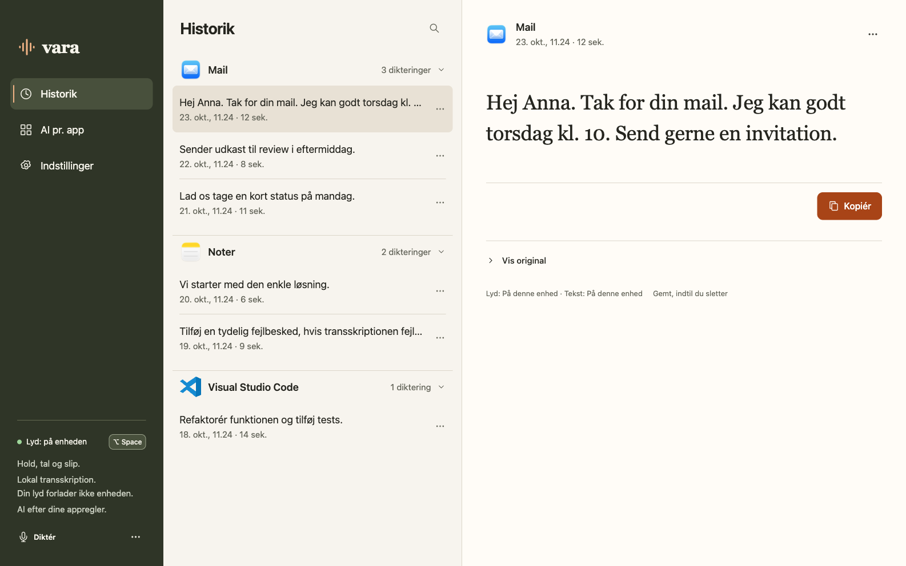

# Desktop UI review — 23 October 2026

The production Rust desktop UI was reviewed against DESIGN.md and the first
Warm precision mockup. The olive sidebar, warm paper surfaces, quiet orange
accents, three-pane proportions and serif reading area are shared across the
actual app and canonical components.

## Reviewed surfaces

- App-grouped history, search, selection, original/processed text, copy and deletion.
- App AI rules, app picker, general/app prompts and one-shot processing choice.
- Dictation settings, shortcut capture, hold/toggle, audio-device selection.
- Connections, local model readiness/download states, API-key/model/endpoint dialogs
  and optional CLI capability presentation.
- Privacy/retention settings, recovery, persistent failures and empty states.
- All three onboarding steps, denied permissions and missing-model guidance.
- Validation, unsaved edits, dialogs, keyboard focus, reduced motion, long text,
  intermediate master/detail layouts and narrow reflow.

Shared dialog spacing, title hierarchy and buttons were normalized. Native WebKit
select styling was corrected to preserve the same padded 44px control height. Setup now
shows one current step. Technical connection settings are optional disclosures.
Capture controls sit quietly in the sidebar; history keeps the mockup's simple
search header. Native titlebar traffic-light spacing is reserved. Forms preserve
focus and unsaved input while live state updates; secret input is cleared when its
dialog closes. Errors remain visible until addressed.

## Evidence

The production browser suite passed **10 groups**, at widths 1586, 1280, 1040, 900,
720, 640 and 320 px, without JavaScript errors. A regression test leaves device enumeration unresolved and confirms that fresh
onboarding remains usable. Actual default-profile native startup was also verified
after replacing blocking CoreAudio probes with metadata enumeration.

This uses an isolated mock IPC
transport and explicitly fictional records, outside packaged assets. Details:
[desktop-ui-review.json](desktop-ui-review.json).

The final normal release build (23.59 MiB; no test-harness feature) was opened
and its history/settings inspected. Closing and reopening the main window worked.

The native Mac window and nonactivating 520×76 dictation capsule were inspected
on the unlocked Mac. The capsule uses actual native app identity, shared generated
colors, stage text, real microphone-level input and explicit stop/cancel controls.
Fixture replay has no microphone level and correctly shows flat dots. Stopping
through the native capsule ran real local transcription, saved one manual-ready
history result and left no recovery, staging or audio file. Switching to TextEdit
when the session originated in Vara did not insert text there.

The optimized local sample measured 0.41 s recognition and 2.57 s optional local
text inference on this Mac. This is one sample, not an accuracy/performance
benchmark; Whisper Base produced several Danish recognition errors.

## Limits

A visual review does not establish full release readiness. Physical global-hotkey
activation, real microphone-to-field insertion, live provider credentials and
Windows/Linux native behavior remain unverified. Windows/Linux native targeting
and HUD adapters are unfinished. No human design acceptance is inferred from this
agent review. See [desktop README](../../desktop/README.md).
